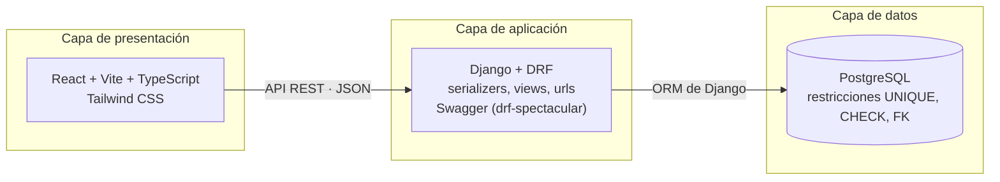

# Arquitectura del módulo de Cuentas por Pagar

Resumen del documento de arquitectura aprobado por el equipo (autores: Daniel Guillen y Brigitte Mengoa; docente: Juan Carlos Juárez Bueno). Registra las decisiones tecnológicas y su razón. La aplicación de estas decisiones al repositorio se describe en la [guía de implementación](GUIA_IMPLEMENTACION.md).

## 1. Objetivo y alcance

El primer incremento es un CRUD de obligaciones con proveedores: **registrar, consultar, modificar y anular**. Debe impedir comprobantes duplicados y datos inválidos, como montos negativos. Los campos, reglas y restricciones concretas los define el Product Owner en [T-02](https://github.com/LeonHatches/fsi-erp-cuentas-por-pagar/issues/3).

El registro de pagos se aborda en un incremento posterior; las tecnologías se eligieron también pensando en esa etapa, en la que se aplicarán pagos y se actualizarán saldos sin errores.

## 2. Criterios de comparación

| Criterio | Qué se evalúa |
|---|---|
| Integridad de los datos | Restricciones (PK, FK, UNIQUE, CHECK), transacciones y manejo exacto de montos. |
| Facilidad para el equipo | Curva de aprendizaje y documentación disponible. |
| Rapidez de implementación | Tiempo necesario para el primer incremento funcional. |
| Documentación de servicios | Facilidad para mostrar qué datos recibe y devuelve cada servicio. |
| Costo y licencia | Uso gratuito para el desarrollo del curso. |
| Crecimiento e integración | Posibilidad de ampliar el módulo y conectarlo con el ERP. |

## 3. Decisiones y alternativas

| Componente | Elegido | Alternativas evaluadas | Razón principal |
|---|---|---|---|
| Base de datos | **PostgreSQL** | MySQL, SQL Server, SQLite | Gratuito; `NUMERIC` exacto; PK, FK, UNIQUE y CHECK completas; transacciones ACID; es la base de Odoo. SQLite se descarta por no manejar decimales exactos. |
| Lenguaje | **Python** | Java, JavaScript (Node.js), C# | Curva de aprendizaje baja; tipo `Decimal` para montos; es el lenguaje de Odoo. JavaScript se descarta en el backend por usar punto flotante. |
| Backend | **Django + Django REST Framework** | FastAPI, Flask | Estructura definida (proyecto, apps, models, serializers, views, urls); ORM; panel de administración; Swagger con drf-spectacular. |
| Acceso a datos | **ORM de Django con migraciones** | Script manual + ORM sobre tablas existentes; script manual + SQL directo | Una sola definición de las tablas (los modelos), sin riesgo de desincronización, con restricciones mediante `Meta.constraints` y base de prueba creada desde las migraciones. |
| Frontend | **React + Vite** | HTML/CSS/JavaScript; plantillas de Django | Componentes reutilizables (formularios, tablas, mensajes) y separación del backend, del que consume la API. |
| Lenguaje del frontend | **TypeScript** | JavaScript | Interfaces que reflejan el contrato de API; DRF envía los montos como texto para conservar su precisión y TypeScript permite declararlos así. |
| Estilos | **Tailwind CSS** | CSS propio, Bootstrap | Escala común de colores y espaciados entre pantallas; plugin oficial para Vite; el archivo final solo incluye los estilos usados. |
| Pruebas | **pytest y pytest-django** | — | Automatizan el recorrido completo con una base de prueba creada desde las migraciones. |

### Acceso a la base de datos

La estructura se define en los modelos de Django. Las relaciones se declaran con campos `models.ForeignKey`; las restricciones de unicidad y comprobación pueden declararse con `models.UniqueConstraint` y `models.CheckConstraint` en `Meta.constraints`. Las migraciones crean estas relaciones y restricciones en PostgreSQL.

- `python manage.py makemigrations` genera las migraciones a partir de los cambios en los modelos.
- `python manage.py migrate` aplica las migraciones pendientes y registra su ejecución en la base de datos.
- `python manage.py sqlmigrate <app> <migracion>` muestra el SQL de una migración específica; no lo ejecuta ni genera automáticamente un esquema completo del proyecto. `database/01_estructura.sql` conserva ese SQL como referencia documental, con la aplicación y migración de origen identificadas. Su contenido se obtiene de las migraciones y no se modifica a mano. La creación y actualización de la base se realiza con `migrate`, no ejecutando esta referencia SQL.
- `02_datos_prueba.sql` contiene registros de ejemplo y no modifica la estructura. Su carga se realiza sobre una base de pruebas con las migraciones aplicadas.

### Herramientas complementarias

| Herramienta | Uso |
|---|---|
| Git y GitHub | Control de versiones, ramas por actividad y revisión mediante pull requests. |
| DBeaver o pgAdmin | Revisar tablas y cargar datos de prueba sobre una base migrada; los cambios de estructura se aplican con Django. |
| Panel de administración de Django | Consultar y cargar datos sin depender del frontend. |
| Swagger UI (drf-spectacular) | Documentar y probar los servicios del backend. |
| django-cors-headers | Permitir que React consuma la API desde otro puerto. |
| pytest y pytest-django | Pruebas automáticas. |
| Node.js y npm | Crear y ejecutar el proyecto React, Vite y TypeScript; instalar Tailwind CSS. |
| Entorno virtual (venv) y `requirements.txt` | Instalar las mismas dependencias de Python en todas las máquinas. |

## 4. Arquitectura propuesta

El programa se organiza en tres capas. El frontend se comunica con el backend mediante una API REST que intercambia JSON, y el backend es la única capa que accede a la base de datos.

### Flujo: registrar una obligación

1. El usuario completa el formulario con los datos definidos por el Product Owner.
2. El componente de React, tipado con TypeScript, envía los datos a la API en JSON.
3. El serializer de DRF valida los datos (por ejemplo, monto mayor que cero y proveedor existente).
4. Si son válidos, el backend guarda la obligación. Si el comprobante ya existe, la restricción UNIQUE de la base lo impide y la API responde con un mensaje de error.
5. La API devuelve la obligación registrada y el frontend actualiza el listado.

Consultar y modificar siguen el mismo recorrido. **Anular no elimina el registro**: cambia su estado a anulada, para conservar el historial de deudas.

### Validaciones en dos niveles

Las reglas se controlan en el backend, para mostrar mensajes claros, y también en la base de datos, para que ningún dato incorrecto se guarde aunque falle el código. Un comprobante duplicado se impide con UNIQUE y un monto negativo con CHECK; ambas se definen en los modelos. Las tablas y atributos exactos dependen del diccionario de datos ([T-04](https://github.com/LeonHatches/fsi-erp-cuentas-por-pagar/issues/5)).

### Incremento posterior: registro de pagos

Cada pago se aplicará dentro de una transacción (`transaction.atomic`): el backend verificará que no supere el saldo pendiente y, en la misma operación, registrará el pago y actualizará el saldo. Por ejemplo, una obligación de 100 con un pago de 40 queda con saldo de 60. La arquitectura no requiere cambios para esta etapa.

## 5. Integración con el ERP

El ERP utiliza las tecnologías acordadas entre los módulos: Python con Django REST Framework para el backend, React con Vite y TypeScript para el frontend, PostgreSQL como base de datos y Tailwind CSS para los estilos. Cuentas por Pagar adopta este conjunto tecnológico y se integra mediante contratos de API REST con intercambio de JSON. La información compartida y las responsabilidades de cada módulo se coordinan con los equipos correspondientes.

## Referencias

- [PostgreSQL](https://www.postgresql.org/docs/) · [MySQL](https://dev.mysql.com/doc/) · [SQLite: tipos de datos](https://www.sqlite.org/datatype3.html)
- [Python: decimal](https://docs.python.org/3/library/decimal.html)
- [Django: migraciones](https://docs.djangoproject.com/en/stable/topics/migrations/) · [Django: restricciones](https://docs.djangoproject.com/en/stable/ref/models/constraints/)
- [Django: ForeignKey](https://docs.djangoproject.com/en/stable/ref/models/fields/#foreignkey) · [Django: sqlmigrate](https://docs.djangoproject.com/en/stable/ref/django-admin/#sqlmigrate)
- [Django REST Framework](https://www.django-rest-framework.org/) · [drf-spectacular](https://drf-spectacular.readthedocs.io/)
- [React](https://react.dev/) · [Vite](https://vite.dev/) · [TypeScript](https://www.typescriptlang.org/docs/) · [Tailwind CSS](https://tailwindcss.com/docs)
- [Odoo: documentación para desarrolladores](https://www.odoo.com/documentation/)
