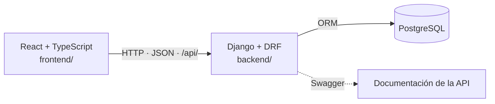
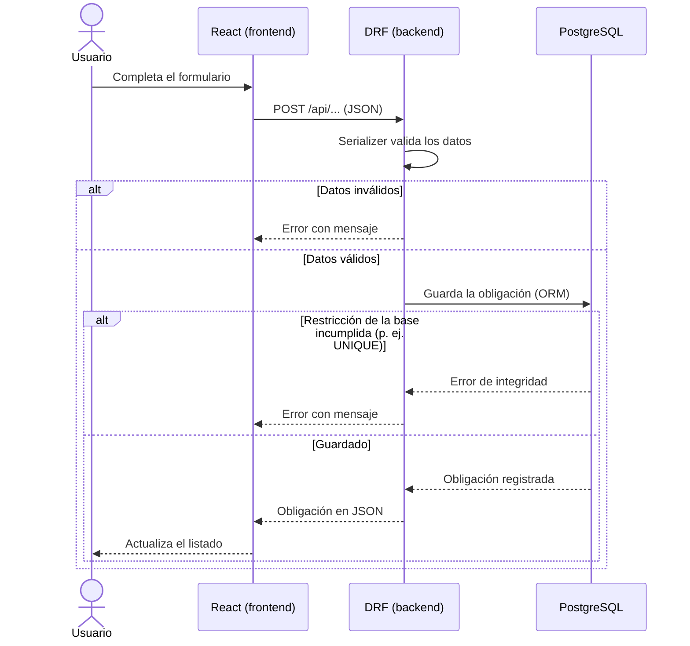

# Guía de implementación

Esta guía explica cómo se organiza el programa del módulo de Cuentas por Pagar y qué parte completa cada tarea. Las decisiones tecnológicas y su justificación completa están en [ARQUITECTURA.md](ARQUITECTURA.md). Los campos, reglas y endpoints no se definen aquí: los establecen las tareas indicadas en cada sección.

## 1. Tecnologías

| Componente | Tecnología | Justificación breve |
|---|---|---|
| Base de datos | PostgreSQL | Restricciones completas, montos exactos y transacciones. |
| Backend | Python, Django y Django REST Framework | Estructura definida y servicios REST; el ORM crea las tablas desde los modelos. |
| Documentación de la API | drf-spectacular (Swagger) | Muestra los datos que recibe y devuelve cada servicio. |
| Frontend | React, Vite y TypeScript | Componentes reutilizables y tipado de los datos de la API. |
| Estilos | Tailwind CSS | Apariencia consistente entre pantallas. |
| Pruebas | pytest y pytest-django | Pruebas con una base creada desde las migraciones. |

## 2. Función de cada carpeta

| Carpeta | Función | Responsable | Tareas |
|---|---|---|---|
| [backend/](../../backend/README.md) | Proyecto Django y DRF: modelos, migraciones, API y pruebas. | Fernando Gerson (Backend) | [T-11](https://github.com/LeonHatches/fsi-erp-cuentas-por-pagar/issues/12), [T-12](https://github.com/LeonHatches/fsi-erp-cuentas-por-pagar/issues/13), [T-16](https://github.com/LeonHatches/fsi-erp-cuentas-por-pagar/issues/17) |
| [frontend/](../../frontend/README.md) | Proyecto React, Vite y TypeScript con las pantallas del CRUD. | José Manuel (Frontend) | [T-14](https://github.com/LeonHatches/fsi-erp-cuentas-por-pagar/issues/15), [T-17](https://github.com/LeonHatches/fsi-erp-cuentas-por-pagar/issues/18) |
| [database/](../../database/README.md) | SQL de migraciones como referencia documental y datos de prueba. | Fernando Gerson (estructura) y Flor (datos) | [T-12](https://github.com/LeonHatches/fsi-erp-cuentas-por-pagar/issues/13), [T-08](https://github.com/LeonHatches/fsi-erp-cuentas-por-pagar/issues/9) |
| [pruebas/](../../pruebas/README.md) | Casos y resultados de QA. | Flor (QA) | [T-08](https://github.com/LeonHatches/fsi-erp-cuentas-por-pagar/issues/9), [T-20](https://github.com/LeonHatches/fsi-erp-cuentas-por-pagar/issues/21) |
| [docs/bocetos/](../bocetos/README.md) | Wireframes y bocetos de las pantallas. | José Manuel; revisa Rafael | [T-09](https://github.com/LeonHatches/fsi-erp-cuentas-por-pagar/issues/10), [T-10](https://github.com/LeonHatches/fsi-erp-cuentas-por-pagar/issues/11) |
| `docs/arquitectura/` | Arquitectura y esta guía. | Daniel (Arquitectura) | [T-03](https://github.com/LeonHatches/fsi-erp-cuentas-por-pagar/issues/4) |
| `docs/planificacion/` | Planificación y flujo del incremento (Scrum Master). | Hatches | [T-01](https://github.com/LeonHatches/fsi-erp-cuentas-por-pagar/issues/2) |

## 3. Estructura prevista de backend y frontend

Los árboles siguientes son **orientativos**. Se crean en T-11, T-12, T-14 y T-17; esta tarea no genera los proyectos. El responsable de cada tarea puede ajustar los nombres al crear el proyecto, siempre que respete la separación de capas descrita en la sección 4.

### Backend (Django y DRF)

```text
backend/
  manage.py
  requirements.txt
  .env.example
  config/                 configuración del proyecto (settings, urls raíz)
  cuentas_por_pagar/      app del módulo
    models.py             tablas y restricciones (Meta.constraints)
    migrations/
    serializers.py        validación de datos de entrada y salida
    views.py              endpoints de la API
    urls.py               rutas bajo /api/
    admin.py              revisión de datos en Django Admin
    tests/
```

| Elemento | Qué contiene y por qué está separado |
|---|---|
| `manage.py` | Punto de entrada de los comandos de Django: `makemigrations` genera migraciones, `migrate` las aplica y `sqlmigrate` muestra su SQL. También permite ejecutar el servidor y otros comandos. |
| `requirements.txt` | Dependencias de Python; permite instalar las mismas versiones en todas las máquinas. |
| `.env.example` | Ejemplo de variables de entorno sin valores reales. Su contenido se define en [T-07](https://github.com/LeonHatches/fsi-erp-cuentas-por-pagar/issues/8); no se suben credenciales. |
| `config/` | Configuración global: base de datos, aplicaciones instaladas, CORS, drf-spectacular y rutas raíz. |
| `cuentas_por_pagar/` | App del módulo; agrupa todo lo propio de Cuentas por Pagar. |
| `models.py` | Definición de tablas y relaciones mediante campos como `models.ForeignKey`; restricciones `UniqueConstraint` y `CheckConstraint` en `Meta.constraints`. |
| `migrations/` | Historial versionado de cambios de estructura, generado con `makemigrations` y aplicado con `migrate`. |
| `serializers.py` | Valida los datos que entran y define los que salen; produce los mensajes de error. |
| `views.py` | Endpoints de la API; reciben la petición, usan serializers y modelos y responden JSON. |
| `urls.py` | Rutas del módulo bajo el prefijo `/api/`. |
| `admin.py` | Registro de los modelos en Django Admin para revisar y cargar datos sin el frontend. |
| `tests/` | Pruebas con pytest y pytest-django. |

### Frontend (React, Vite y TypeScript)

```text
frontend/
  package.json
  vite.config.ts
  src/
    api/                  llamadas a la API (fetch)
    types/                interfaces TypeScript según el contrato de API
    components/           componentes reutilizables (formularios, tablas, mensajes)
    pages/                pantallas del CRUD de obligaciones
    App.tsx
    main.tsx              punto de entrada de React
    index.css             importación de Tailwind CSS
```

| Elemento | Qué contiene y por qué está separado |
|---|---|
| `package.json` | Dependencias y scripts de npm. |
| `vite.config.ts` | Configuración de Vite y del plugin de Tailwind CSS. |
| `src/api/` | Única capa que llama a la API; las pantallas no construyen peticiones por su cuenta. |
| `src/types/` | Interfaces TypeScript que reflejan el contrato de API de [T-13](https://github.com/LeonHatches/fsi-erp-cuentas-por-pagar/issues/14); los montos se declaran como texto, como los envía DRF. |
| `src/components/` | Piezas reutilizables, como formularios, tablas y mensajes. |
| `src/pages/` | Pantallas del CRUD de obligaciones, definidas por los bocetos de T-09 y T-10. |
| `App.tsx` | Componente raíz de la aplicación. |
| `main.tsx` | Punto de entrada de React; monta `App` en la página. |
| `index.css` | Importa Tailwind CSS, cuyas clases se aplican en los componentes. |

## 4. Responsabilidad de cada capa

| Capa | Responsabilidad | No debe hacer |
|---|---|---|
| Frontend (React) | Mostrar pantallas, recoger datos del usuario, enviar y recibir JSON, mostrar los errores devueltos. | Acceder a la base de datos ni ser la única validación de una regla. |
| Backend (Django y DRF) | Exponer la API, validar con serializers, aplicar las reglas del módulo, acceder a los datos con el ORM. | Mostrar pantallas ni confiar en que el frontend valide. |
| Base de datos (PostgreSQL) | Guardar los datos y hacer cumplir las restricciones (UNIQUE, CHECK, FK) aunque falle el código. | Contener reglas que no estén definidas en los modelos. |

El backend es la única capa que accede a la base de datos. Las reglas se validan en el backend, para dar mensajes claros, y en la base, como garantía final.

## 5. Integración entre frontend, backend y base de datos



Se acuerdan estas **convenciones**; el detalle lo define [T-13](https://github.com/LeonHatches/fsi-erp-cuentas-por-pagar/issues/14).

- **REST y JSON:** el frontend y el backend solo intercambian JSON mediante HTTP.
- **Prefijo `/api/`:** todas las rutas del backend consumidas por el frontend cuelgan de este prefijo.
- **CORS:** como React se ejecuta en otro puerto durante el desarrollo, el backend habilita ese origen con `django-cors-headers`.
- **Errores:** la API responde con un código HTTP adecuado y un cuerpo JSON con mensajes que el frontend puede mostrar al usuario. La estructura exacta se fija en T-13.
- **Montos como texto:** DRF envía los montos como texto para conservar su precisión; el frontend no los opera como números de punto flotante.
- **Swagger:** drf-spectacular documenta y permite probar los servicios.

Los campos, endpoints y reglas concretas no están en esta guía: los campos y reglas los define [T-02](https://github.com/LeonHatches/fsi-erp-cuentas-por-pagar/issues/3), el diccionario de datos [T-04](https://github.com/LeonHatches/fsi-erp-cuentas-por-pagar/issues/5), los modelos [T-12](https://github.com/LeonHatches/fsi-erp-cuentas-por-pagar/issues/13) y el contrato de API [T-13](https://github.com/LeonHatches/fsi-erp-cuentas-por-pagar/issues/14).

## 6. Flujo de ejemplo: registrar una obligación



1. El usuario completa el formulario con los datos definidos por el Product Owner.
2. El componente de React envía los datos a la API en JSON.
3. El serializer valida los datos; por ejemplo, que el monto sea mayor que cero y que el proveedor exista.
4. Si son válidos, el backend guarda la obligación. Si una restricción de la base se incumple, como un comprobante duplicado (UNIQUE), la API responde con un mensaje de error.
5. La API devuelve la obligación registrada y el frontend actualiza el listado.

Consultar y modificar siguen el mismo recorrido. **Anular** no elimina el registro: cambia su estado a anulada para conservar el historial. Las condiciones para anular o modificar una obligación se definen en [T-02](https://github.com/LeonHatches/fsi-erp-cuentas-por-pagar/issues/3). El ejemplo es ilustrativo; los campos y la ruta reales dependen de T-02 y T-13.

## 7. Reglas de trabajo

1. **Los modelos de Django son la única fuente de la estructura.** Las tablas, columnas y restricciones se definen una sola vez en `models.py`; no se crean ni modifican tablas a mano en PostgreSQL.
2. **Las migraciones crean y actualizan la base de datos.** `python manage.py makemigrations` genera los cambios y `python manage.py migrate` los aplica. `sqlmigrate <app> <migracion>` muestra el SQL de una migración específica. `database/01_estructura.sql` es una referencia documental identificada por aplicación y migración; no representa automáticamente el esquema completo ni se ejecuta en sustitución de `migrate`. Los datos de ejemplo van en `02_datos_prueba.sql` y se cargan sobre una base de pruebas ya migrada.
3. **Los cambios de estructura se hacen mediante PR.** El cambio incluye los modelos, las migraciones generadas y la actualización de la referencia SQL cuando corresponda. La comprobación incluye aplicar las migraciones con `migrate`. La revisión se registra en el pull request, conforme al [flujo de colaboración](../../CONTRIBUTING.md).
4. **Las reglas se validan en dos niveles:** en el backend y en la base de datos.
5. **Anular es un cambio de estado,** no un borrado. Las condiciones para anular o modificar una obligación se definen en [T-02](https://github.com/LeonHatches/fsi-erp-cuentas-por-pagar/issues/3).
6. **No se suben credenciales, entornos virtuales ni dependencias descargadas.**

## 8. Qué tarea completa cada parte

| Parte | Tarea | Responsable |
|---|---|---|
| Alcance, campos y reglas | [T-02](https://github.com/LeonHatches/fsi-erp-cuentas-por-pagar/issues/3) | Rafael (Product Owner) |
| Arquitectura, esta guía y estructura inicial | [T-03](https://github.com/LeonHatches/fsi-erp-cuentas-por-pagar/issues/4) | Daniel (Arquitectura) |
| Diccionario de datos y diagrama de relaciones | [T-04](https://github.com/LeonHatches/fsi-erp-cuentas-por-pagar/issues/5) | Fernando Gerson (Backend) |
| Patrones de diseño | [T-05](https://github.com/LeonHatches/fsi-erp-cuentas-por-pagar/issues/6) | Brigitte Noelia (Patrones) |
| Configuración y guía de entornos | [T-07](https://github.com/LeonHatches/fsi-erp-cuentas-por-pagar/issues/8) | Romina (DevOps) |
| Casos y datos de prueba | [T-08](https://github.com/LeonHatches/fsi-erp-cuentas-por-pagar/issues/9) | Flor (QA) |
| Bocetos y su revisión | [T-09](https://github.com/LeonHatches/fsi-erp-cuentas-por-pagar/issues/10), [T-10](https://github.com/LeonHatches/fsi-erp-cuentas-por-pagar/issues/11) | José Manuel; Rafael |
| Proyecto Django, DRF y PostgreSQL | [T-11](https://github.com/LeonHatches/fsi-erp-cuentas-por-pagar/issues/12) | Fernando Gerson |
| Modelos, migraciones y referencia SQL | [T-12](https://github.com/LeonHatches/fsi-erp-cuentas-por-pagar/issues/13) | Fernando Gerson |
| Contrato de API | [T-13](https://github.com/LeonHatches/fsi-erp-cuentas-por-pagar/issues/14) | Fernando Gerson, con Frontend |
| Proyecto React y pantallas | [T-14](https://github.com/LeonHatches/fsi-erp-cuentas-por-pagar/issues/15) | José Manuel |
| Verificaciones automáticas | [T-15](https://github.com/LeonHatches/fsi-erp-cuentas-por-pagar/issues/16) | Romina (DevOps) |
| Servicios del CRUD y sus pruebas | [T-16](https://github.com/LeonHatches/fsi-erp-cuentas-por-pagar/issues/17) | Fernando Gerson |
| Conexión de las pantallas con la API | [T-17](https://github.com/LeonHatches/fsi-erp-cuentas-por-pagar/issues/18) | José Manuel |
| Revisión de la integración técnica | [T-18](https://github.com/LeonHatches/fsi-erp-cuentas-por-pagar/issues/19) | Daniel (Arquitectura) |

## 9. Configuración y ejecución

Esta sección se completará con los pasos de instalación y ejecución cuando existan los proyectos, con los aportes de T-07 (entornos), T-11 (backend y PostgreSQL) y T-14 (frontend). Hasta entonces solo indica qué tarea aporta cada parte.

| Qué | Aporte a esta sección | Tarea |
|---|---|---|
| Entornos, variables, versiones y automatización | Pasos de preparación del entorno | [T-07](https://github.com/LeonHatches/fsi-erp-cuentas-por-pagar/issues/8) |
| Creación, configuración y ejecución del backend y PostgreSQL | Pasos de instalación y ejecución del backend | [T-11](https://github.com/LeonHatches/fsi-erp-cuentas-por-pagar/issues/12) |
| Creación, configuración y ejecución del frontend | Pasos de instalación y ejecución del frontend | [T-14](https://github.com/LeonHatches/fsi-erp-cuentas-por-pagar/issues/15) |

Orden general previsto: preparar el entorno (T-07), levantar el backend con PostgreSQL (T-11), levantar el frontend (T-14) y comprobar la comunicación mediante la API (T-17).
