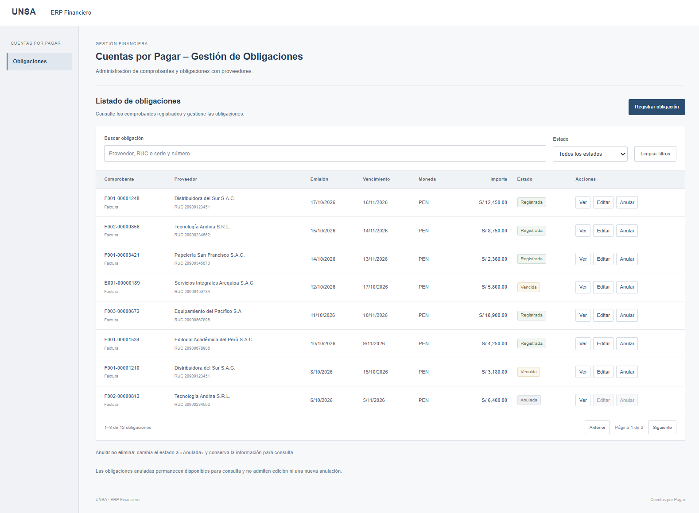
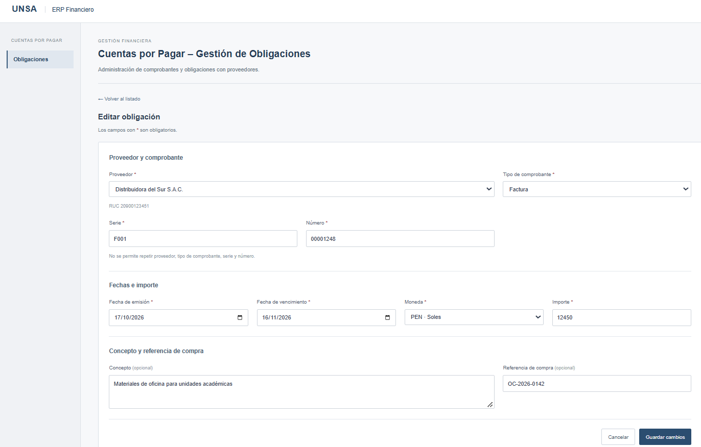
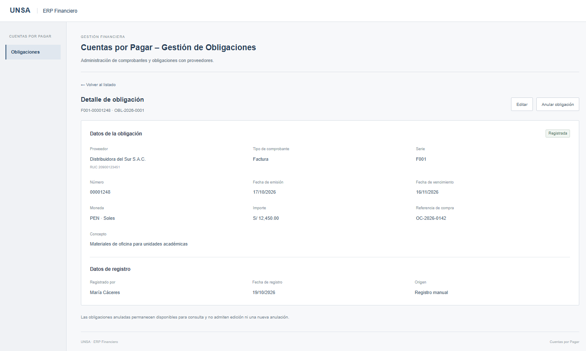
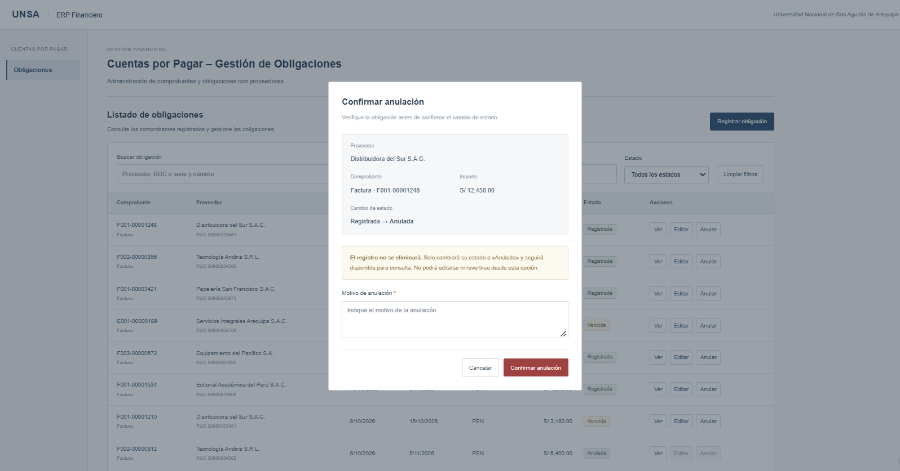
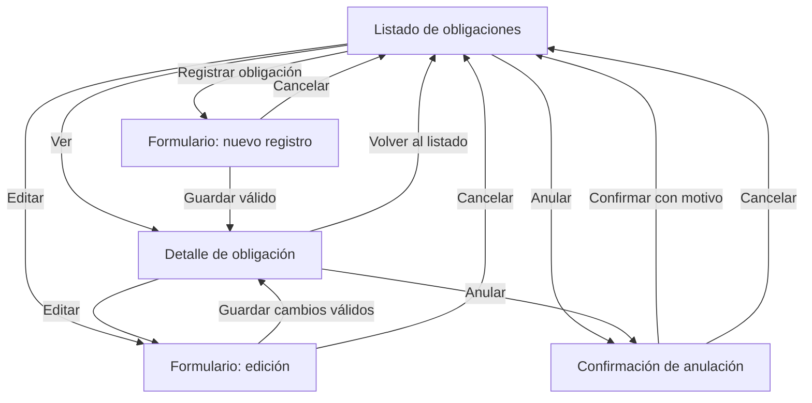

# Bocetos del CRUD de obligaciones — T-09

**Módulo:** Cuentas por Pagar — ERP Financiero  
**Historia de usuario:** [HU-01 — Gestionar las obligaciones](https://github.com/LeonHatches/fsi-erp-cuentas-por-pagar/issues/1)  
**Tarea:** [T-09 — Wireframes y bocetos](https://github.com/LeonHatches/fsi-erp-cuentas-por-pagar/issues/10)  
**Responsable:** José Manuel Morocco Saico — Frontend  
**Revisión funcional:** [T-10 — Product Owner](https://github.com/LeonHatches/fsi-erp-cuentas-por-pagar/issues/11)

## Prototipo interactivo

[Figma Make — Cuentas por Pagar / Gestión de Obligaciones](https://www.figma.com/make/L4wtJet9DA77zIudeqiWIj/Gesti%C3%B3n-de-obligaciones-financieras)

El enlace permite revisar la navegación y las operaciones con datos ficticios. Las imágenes siguientes documentan las cuatro vistas principales. Los bocetos constituyen una propuesta para revisión; no representan una implementación conectada al backend ni una aprobación funcional.

## Pantallas

| Vista | Captura | Función |
|---|---|---|
| Listado | [Ver imagen](listado-obligaciones.png) | Buscar y consultar obligaciones; acceder a las acciones «Ver», «Editar» y «Anular». |
| Formulario | [Ver imagen](formulario-obligacion.png) | Registrar o editar los datos de una obligación. La captura muestra el modo edición; el modo registro se consulta desde «Registrar obligación» en Figma. |
| Detalle | [Ver imagen](detalle-obligacion.png) | Consultar la información de la obligación y sus datos de registro. |
| Confirmación de anulación | [Ver imagen](confirmar-anulacion.png) | Confirmar la anulación con un motivo y conservar el registro para consulta. |

### Listado de obligaciones

### Formulario de registro / edición

### Detalle de obligación

### Confirmación de anulación

## Flujo de navegación

En los formularios se presentan validaciones y mensajes para campos obligatorios, comprobantes repetidos, importes no positivos y fechas inconsistentes. La anulación es un cambio de estado, no una eliminación física del registro. En la propuesta visual, las obligaciones anuladas permanecen consultables y no se pueden editar ni anular nuevamente.

## Campos representados

Proveedor, tipo de comprobante, serie, número, fecha de emisión, fecha de vencimiento, moneda, importe, concepto y referencia de compra. El concepto y la referencia de compra aparecen como opcionales en la propuesta visual.

Los valores, proveedores, comprobantes y personas que aparecen en las capturas son **datos ficticios** empleados para ilustrar las pantallas. El registro de pagos y la implementación del módulo de Compras quedan fuera de HU-01.

## Estados especiales del listado

En la vista previa del prototipo, las siguientes variantes pueden revisarse añadiendo el parámetro indicado a la dirección de la aplicación:

- `?estado=vacio`: listado sin obligaciones.
- `?estado=carga`: estado de carga temporal.
- `?estado=error`: mensaje de error con opción de reintentar.
- Sin parámetro: listado con datos de muestra.

La búsqueda sin coincidencias también muestra un estado sin resultados. Estos escenarios forman parte del prototipo y no implican una consulta real al servidor.

## Observaciones para la revisión del Product Owner

- Confirmar los campos obligatorios y las restricciones de registro definidas en T-02.
- Precisar qué campos se podrán modificar y en qué estados.
- Confirmar las condiciones de anulación y si el motivo será obligatorio.
- Validar la presentación de la referencia de compra y la identificación de proveedores conforme al intercambio de datos con otros módulos.
- Revisar la interpretación de duplicados de comprobantes (proveedor, tipo, serie y número) antes de implementar la lógica definitiva en Backend y Frontend.

Los detalles de validación de la propuesta no sustituyen los criterios de aceptación del Product Owner. La implementación de pantallas corresponde a **T-14** y su integración con API a **T-17**.
