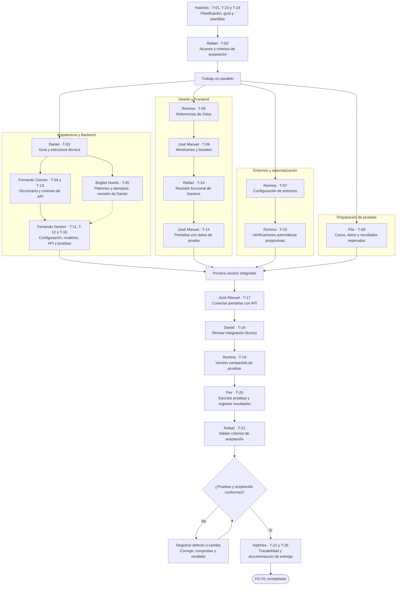

# Planificación del primer CRUD

**Módulo:** Cuentas por Pagar — Tribu de Egresos.  
**Coordinación:** José León Enrique Hatches Curo — Scrum Master.

- [Project: Cuentas por Pagar — Primer CRUD](https://github.com/users/LeonHatches/projects/1).
- [HU-01: gestionar las obligaciones de Cuentas por Pagar](https://github.com/LeonHatches/fsi-erp-cuentas-por-pagar/issues/1).
- [Issues del repositorio](https://github.com/LeonHatches/fsi-erp-cuentas-por-pagar/issues).
- [Guía de colaboración](../../CONTRIBUTING.md).

## Objetivo del incremento

Disponer de una primera versión para registrar, consultar, modificar y anular obligaciones con proveedores. El registro de pagos se abordará en otro incremento. La identificación de proveedores y comprobantes se coordina con los datos compartidos del ERP; este CRUD no implica desarrollar el módulo de Compras.

## Historia de usuario

**HU-01 — Product Owner — Gestionar las obligaciones de Cuentas por Pagar.**

Como usuario de Cuentas por Pagar, quiero registrar, consultar, modificar y anular obligaciones con proveedores para controlar las deudas pendientes.

Rafael define los criterios de aceptación en [T-02](https://github.com/LeonHatches/fsi-erp-cuentas-por-pagar/issues/3): campos, reglas, restricciones de modificación y anulación, y resultados esperados. Se enlazará su definición desde HU-01. La planificación no sustituye esa validación funcional.

## Tecnologías acordadas

| Componente | Tecnología |
|---|---|
| Backend | Python y Django REST Framework |
| Frontend | React, Vite y TypeScript |
| Base de datos | PostgreSQL |
| Estilos | Tailwind CSS |

Daniel incorpora la guía de arquitectura existente y define la estructura técnica de carpetas en T-03. Fernando Gerson actualiza el diccionario y el diagrama de datos en T-04. La planificación y las plantillas del repositorio corresponden a las tareas de organización de Hatches.

## Tareas y responsables

Los números identifican tareas, no una secuencia obligatoria. Las dependencias representan insumos; las partes independientes pueden avanzar en paralelo. El estado actualizado se consulta en el Project.

| Tarea | Trabajo | Responsable | Insumos principales |
|---|---|---|---|
| [T-01](https://github.com/LeonHatches/fsi-erp-cuentas-por-pagar/issues/2) | Organizar el repositorio, los issues y el tablero | José León Enrique Hatches Curo — Scrum Master | Inicio |
| [T-02](https://github.com/LeonHatches/fsi-erp-cuentas-por-pagar/issues/3) | Definir el alcance y los criterios de aceptación | Fernando Rafael Solsol Choque — Product Owner | Inicio |
| [T-03](https://github.com/LeonHatches/fsi-erp-cuentas-por-pagar/issues/4) | Incorporar la guía de arquitectura y crear la estructura inicial | Daniel Josue Guillen Valcarcel — Arquitectura | Inicio |
| [T-04](https://github.com/LeonHatches/fsi-erp-cuentas-por-pagar/issues/5) | Revisar el diccionario de datos y el diagrama de relaciones | Fernando Gerson Luque Guevara — Backend | [T-02](https://github.com/LeonHatches/fsi-erp-cuentas-por-pagar/issues/3) |
| [T-05](https://github.com/LeonHatches/fsi-erp-cuentas-por-pagar/issues/6) | Documentar los patrones de diseño aplicables | Brigitte Noelia Mengoa Valeriano — Investigación con IA / Patrones de diseño | [T-03](https://github.com/LeonHatches/fsi-erp-cuentas-por-pagar/issues/4) |
| [T-06](https://github.com/LeonHatches/fsi-erp-cuentas-por-pagar/issues/7) | Recopilar referencias de Odoo para el primer CRUD | Romina Giuliana Camargo Hilachoque — Analista de Odoo / Investigadora | [T-02](https://github.com/LeonHatches/fsi-erp-cuentas-por-pagar/issues/3) |
| [T-07](https://github.com/LeonHatches/fsi-erp-cuentas-por-pagar/issues/8) | Preparar la configuración y la guía de entornos | Romina Giuliana Camargo Hilachoque — DevOps | [T-03](https://github.com/LeonHatches/fsi-erp-cuentas-por-pagar/issues/4) |
| [T-08](https://github.com/LeonHatches/fsi-erp-cuentas-por-pagar/issues/9) | Preparar los casos y datos de prueba | Flor de Liz Velazque Quispe — QA / Tester | [T-02](https://github.com/LeonHatches/fsi-erp-cuentas-por-pagar/issues/3) |
| [T-09](https://github.com/LeonHatches/fsi-erp-cuentas-por-pagar/issues/10) | Elaborar los wireframes y bocetos del CRUD | José Manuel Morocco Saico — Frontend | [T-04](https://github.com/LeonHatches/fsi-erp-cuentas-por-pagar/issues/5), [T-06](https://github.com/LeonHatches/fsi-erp-cuentas-por-pagar/issues/7) |
| [T-10](https://github.com/LeonHatches/fsi-erp-cuentas-por-pagar/issues/11) | Revisar los bocetos y registrar observaciones | Fernando Rafael Solsol Choque — Product Owner | [T-09](https://github.com/LeonHatches/fsi-erp-cuentas-por-pagar/issues/10), [T-02](https://github.com/LeonHatches/fsi-erp-cuentas-por-pagar/issues/3) |
| [T-11](https://github.com/LeonHatches/fsi-erp-cuentas-por-pagar/issues/12) | Configurar Django REST Framework y PostgreSQL | Fernando Gerson Luque Guevara — Backend | [T-03](https://github.com/LeonHatches/fsi-erp-cuentas-por-pagar/issues/4), [T-07](https://github.com/LeonHatches/fsi-erp-cuentas-por-pagar/issues/8) |
| [T-12](https://github.com/LeonHatches/fsi-erp-cuentas-por-pagar/issues/13) | Implementar modelos, migraciones y validación en Django Admin | Fernando Gerson Luque Guevara — Backend | [T-11](https://github.com/LeonHatches/fsi-erp-cuentas-por-pagar/issues/12), [T-04](https://github.com/LeonHatches/fsi-erp-cuentas-por-pagar/issues/5) |
| [T-13](https://github.com/LeonHatches/fsi-erp-cuentas-por-pagar/issues/14) | Definir el contrato de API con Frontend | Fernando Gerson Luque Guevara — Backend | [T-04](https://github.com/LeonHatches/fsi-erp-cuentas-por-pagar/issues/5), [T-02](https://github.com/LeonHatches/fsi-erp-cuentas-por-pagar/issues/3) |
| [T-14](https://github.com/LeonHatches/fsi-erp-cuentas-por-pagar/issues/15) | Configurar React e implementar las pantallas del CRUD | José Manuel Morocco Saico — Frontend | [T-07](https://github.com/LeonHatches/fsi-erp-cuentas-por-pagar/issues/8), [T-10](https://github.com/LeonHatches/fsi-erp-cuentas-por-pagar/issues/11), [T-13](https://github.com/LeonHatches/fsi-erp-cuentas-por-pagar/issues/14) |
| [T-15](https://github.com/LeonHatches/fsi-erp-cuentas-por-pagar/issues/16) | Automatizar las verificaciones del proyecto | Romina Giuliana Camargo Hilachoque — DevOps | [T-11](https://github.com/LeonHatches/fsi-erp-cuentas-por-pagar/issues/12) |
| [T-16](https://github.com/LeonHatches/fsi-erp-cuentas-por-pagar/issues/17) | Implementar y probar los servicios del CRUD | Fernando Gerson Luque Guevara — Backend | [T-12](https://github.com/LeonHatches/fsi-erp-cuentas-por-pagar/issues/13), [T-13](https://github.com/LeonHatches/fsi-erp-cuentas-por-pagar/issues/14), [T-02](https://github.com/LeonHatches/fsi-erp-cuentas-por-pagar/issues/3) |
| [T-17](https://github.com/LeonHatches/fsi-erp-cuentas-por-pagar/issues/18) | Conectar las pantallas con la API | José Manuel Morocco Saico — Frontend | [T-14](https://github.com/LeonHatches/fsi-erp-cuentas-por-pagar/issues/15), [T-16](https://github.com/LeonHatches/fsi-erp-cuentas-por-pagar/issues/17) |
| [T-18](https://github.com/LeonHatches/fsi-erp-cuentas-por-pagar/issues/19) | Revisar la integración técnica | Daniel Josue Guillen Valcarcel — Arquitectura | [T-17](https://github.com/LeonHatches/fsi-erp-cuentas-por-pagar/issues/18), [T-05](https://github.com/LeonHatches/fsi-erp-cuentas-por-pagar/issues/6) |
| [T-19](https://github.com/LeonHatches/fsi-erp-cuentas-por-pagar/issues/20) | Preparar la versión compartida de pruebas | Romina Giuliana Camargo Hilachoque — DevOps | [T-17](https://github.com/LeonHatches/fsi-erp-cuentas-por-pagar/issues/18), [T-15](https://github.com/LeonHatches/fsi-erp-cuentas-por-pagar/issues/16) |
| [T-20](https://github.com/LeonHatches/fsi-erp-cuentas-por-pagar/issues/21) | Ejecutar las pruebas y registrar resultados | Flor de Liz Velazque Quispe — QA / Tester | [T-08](https://github.com/LeonHatches/fsi-erp-cuentas-por-pagar/issues/9), [T-19](https://github.com/LeonHatches/fsi-erp-cuentas-por-pagar/issues/20) |
| [T-21](https://github.com/LeonHatches/fsi-erp-cuentas-por-pagar/issues/22) | Validar funcionalmente el primer CRUD | Fernando Rafael Solsol Choque — Product Owner | [T-20](https://github.com/LeonHatches/fsi-erp-cuentas-por-pagar/issues/21), [T-18](https://github.com/LeonHatches/fsi-erp-cuentas-por-pagar/issues/19), [T-02](https://github.com/LeonHatches/fsi-erp-cuentas-por-pagar/issues/3) |
| [T-22](https://github.com/LeonHatches/fsi-erp-cuentas-por-pagar/issues/23) | Comprobar la trazabilidad y actualizar el tablero | José León Enrique Hatches Curo — Scrum Master | [T-21](https://github.com/LeonHatches/fsi-erp-cuentas-por-pagar/issues/22) |
| [T-23](https://github.com/LeonHatches/fsi-erp-cuentas-por-pagar/issues/24) | Documentar ramas, commits y revisiones | José León Enrique Hatches Curo — Scrum Master | Inicio |
| [T-24](https://github.com/LeonHatches/fsi-erp-cuentas-por-pagar/issues/25) | Crear plantillas de issues y pull requests | José León Enrique Hatches Curo — Scrum Master | [T-23](https://github.com/LeonHatches/fsi-erp-cuentas-por-pagar/issues/24) |
| [T-25](https://github.com/LeonHatches/fsi-erp-cuentas-por-pagar/issues/26) | Registrar dependencias, impedimentos y acuerdos | José León Enrique Hatches Curo — Scrum Master | [T-01](https://github.com/LeonHatches/fsi-erp-cuentas-por-pagar/issues/2) |
| [T-26](https://github.com/LeonHatches/fsi-erp-cuentas-por-pagar/issues/27) | Documentar la entrega del primer CRUD | José León Enrique Hatches Curo — Scrum Master | [T-21](https://github.com/LeonHatches/fsi-erp-cuentas-por-pagar/issues/22), [T-22](https://github.com/LeonHatches/fsi-erp-cuentas-por-pagar/issues/23) |

T-15 comienza con el proyecto base y amplía las verificaciones cuando están disponibles el frontend y las pruebas. T-25 acompaña todo el desarrollo. Backend puede revisar datos y configurar el proyecto mientras Brigitte investiga patrones; los aplica después de la revisión técnica correspondiente.

## Flujo de trabajo

Las flechas muestran el recorrido principal. Las coordinaciones entre ramas se detallan después del diagrama para evitar cruces innecesarios.

### Coordinaciones entre ramas

- Los bocetos utilizan el diccionario de T-04 y las referencias de T-06; Frontend usa el contrato de T-13 para preparar datos de prueba y conectar servicios.
- Arquitectura y DevOps acuerdan la configuración inicial; Backend y Frontend la utilizan y verifican.
- Romina distribuye su disponibilidad entre Odoo y DevOps; las ramas representan responsabilidades, no personas distintas.
- QA inicia los casos con los criterios de Rafael y prueba funciones parciales conforme están disponibles.
- Hatches registra dependencias, impedimentos y acuerdos reales en T-25 durante todo el flujo.
- Las correcciones se crean al detectar defectos. No se han definido issues de errores ficticios.

## Entregables de organización

| Tarea | Entregable |
|---|---|
| T-01 | Esta planificación y sus enlaces al tablero y los issues. |
| T-23 | `CONTRIBUTING.md`: ramas, commits, revisiones y estados. |
| T-24 | Plantillas de historia, tarea, error y pull request en `.github/`. |
| T-25 | Registro de seguimiento con hechos y acuerdos cuando se produzcan. |
| T-22 | Revisión de trazabilidad al completar el incremento. |
| T-26 | Documento de entrega con versión validada, evidencias y pendientes. |

El registro de seguimiento y el documento de entrega se incorporan cuando exista contenido real. La creación de issues no significa que las tareas estén terminadas.

## Condiciones de entrega

- Criterios definidos por Rafael y comprobados en la versión integrada.
- Resultados de QA vinculados a los casos y a la versión probada.
- Defectos que impidan cumplir los criterios resueltos y verificados.
- Revisión técnica y aceptación funcional registradas.
- Instrucciones de ejecución, evidencia y pendientes documentados.

Las fechas de entrega y estimaciones se coordinarán con el equipo. Esta planificación no fija compromisos personales ni da por realizadas investigaciones o implementaciones.
