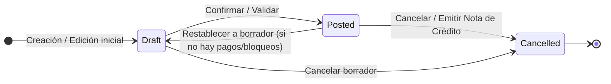
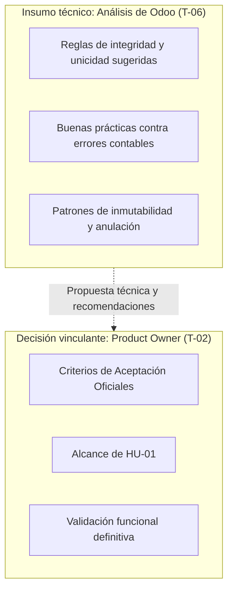

# Referencias de Odoo para el Primer CRUD de Cuentas por Pagar

**Proyecto:** ERP Financiero FSI — Tribu de Egresos  
**Módulo:** Cuentas por Pagar  
**Historia de usuario:** [HU-01 — Gestionar las obligaciones de Cuentas por Pagar](https://github.com/LeonHatches/fsi-erp-cuentas-por-pagar/issues/1)  
**Tarea:** [T-06 — Recopilar referencias de Odoo para el primer CRUD](https://github.com/LeonHatches/fsi-erp-cuentas-por-pagar/issues/7)  
**Responsable:** Romina Giuliana Camargo Hilachoque — Analista de Odoo, investigadora tecnológica y DevOps  
**Destinatarios clave:** José Manuel Morocco Saico (Frontend, [T-09](https://github.com/LeonHatches/fsi-erp-cuentas-por-pagar/issues/10) / [T-14](https://github.com/LeonHatches/fsi-erp-cuentas-por-pagar/issues/15)), Fernando Gerson Luque Guevara (Backend, [T-04](https://github.com/LeonHatches/fsi-erp-cuentas-por-pagar/issues/5) / [T-12](https://github.com/LeonHatches/fsi-erp-cuentas-por-pagar/issues/13)) y Fernando Rafael Solsol Choque (Product Owner, [T-02](https://github.com/LeonHatches/fsi-erp-cuentas-por-pagar/issues/3))  

---

## 1. Introducción y objetivo

El presente documento constituye el informe técnico de la tarea **T-06**, orientado a analizar cómo resuelve el ERP de referencia del mercado (**Odoo**, versiones 17.0 y 18.0) la gestión de facturas de proveedores (*Vendor Bills*), a fin de extraer buenas prácticas funcionales, estructurales y de experiencia de usuario que orienten la construcción de nuestro **primer CRUD de obligaciones con proveedores**.

### 1.1 Contexto del proyecto
En el marco del curso Fundamentos de Sistemas de Información (Escuela Profesional de Ingeniería de Sistemas, Universidad Nacional de San Agustín de Arequipa), el módulo de **Cuentas por Pagar** administra las deudas que la empresa contrae con sus proveedores. Para su primer incremento funcional (**HU-01**), el alcance se encuentra rigurosamente acotado a cuatro operaciones esenciales:
1. **Registrar** obligaciones derivadas de comprobantes de compra.
2. **Consultar** el listado y el detalle de las obligaciones existentes.
3. **Modificar** los datos permitidos de una obligación no anulada.
4. **Anular** obligaciones con registro de motivo y preservación de auditoría.

### 1.2 Delimitación estricta del alcance
Para garantizar el cumplimiento de los acuerdos de equipo y los plazos de entrega:
- **No se implementa el registro ni la conciliación de pagos** (reservados para incrementos posteriores según el [plan del CRUD](../planificacion/primer-crud.md)).
- **No se desarrolla el módulo de Compras** ni el flujo de emparejamiento con órdenes de compra (*3-way matching* / PO).
- **No se replica la contabilidad general de Odoo**, prescindiendo del motor multidimensional de asientos de diario, planes contables complejos o servicios de digitalización OCR por suscripción (IAP).

---

## 2. Análisis de las funcionalidades observadas en Odoo

En Odoo (módulos *Invoicing* y *Accounting*), las obligaciones comerciales con proveedores se gestionan mediante el modelo `account.move` bajo el subtipo `in_invoice` (*Vendor Bill*). El análisis de su documentación oficial revela los siguientes aspectos estructurales:

### 2.1 Ciclo de vida y estados del registro
Odoo maneja un flujo de estados claro que determina las acciones permitidas y la inmutabilidad de los datos:

1. **Borrador (*Draft*):**
   - El documento se encuentra en fase de carga o preparación.
   - Todos los campos (proveedor, fechas, importes, líneas y cuentas) son completamente editables.
   - No genera impacto contable formal vinculante ni modifica los saldos exigibles en los libros oficiales.
2. **Publicado / Confirmado (*Posted*):**
   - La obligación ha sido formalizada. Odoo le asigna una secuencia interna única (por ejemplo, `BILL/2026/11/0001`).
   - El documento pasa a formar parte de las cuentas por pagar exigibles e impacta en los informes de antigüedad de saldos (*Aged Payable*).
   - Los campos contables y financieros críticos quedan **bloqueados para edición directa**, protegiendo la inalterabilidad de los registros contables.
3. **Cancelado (*Cancelled*):**
   - Representa la anulación formal de la obligación.
   - En Odoo, una factura confirmada no se borra físicamente de la base de datos; se marca como cancelada o se compensa mediante una nota de crédito (*Credit Note / Vendor Refund*), preservando la traza histórica para fines de auditoría fiscal.

### 2.2 Campos esenciales observados
Al analizar la cabecera y el cuerpo del formulario de facturas de proveedor en Odoo, se identifican los siguientes campos fundamentales:

| Campo en Odoo | Tipo de dato / Control | Función en Odoo | Relevancia para nuestro CRUD |
|---|---|---|---|
| **Proveedor (*Vendor / `partner_id`*)** | Selector relacional / Búsqueda | Identifica la entidad comercial a la que se le adeuda. | **Indispensable**: Proveedor asociado a la obligación. |
| **Referencia de factura (*Bill Reference / `ref`*)** | Texto alfanumérico | Número o código del comprobante físico emitido por el proveedor. | **Indispensable**: Serie y número del comprobante comercial. |
| **Fecha de factura (*Bill Date / `invoice_date`*)** | Selector de fecha | Fecha formal de emisión del comprobante. | **Indispensable**: Fecha de emisión. |
| **Fecha de vencimiento (*Due Date / `invoice_date_due`*)** | Selector de fecha | Fecha límite pactada para realizar el desembolso. | **Indispensable**: Fecha de vencimiento para control de morosidad. |
| **Moneda (*Currency / `currency_id`*)** | Selector / Catálogo | Moneda en la que se pactó la obligación (PEN, USD, EUR). | **Indispensable**: Gestión de moneda (Soles / Dólares). |
| **Líneas de factura (*Invoice Lines*)** | Grilla editable multidistributiva | Desglose por producto, cuenta contable, cantidad, precio e impuestos. | **Simplificable**: En nuestro primer CRUD se maneja un concepto general y monto totalizado, sin desagregación contable compleja. |
| **Importe total (*Total Amount*)** | Numérico con decimales fijos | Monto total adeudado al proveedor. | **Indispensable**: Importe numérico exacto no negativo. |
| **Estado (*Status / `state`*)** | Badge informativo / Barra de progreso | Indica la etapa actual (`draft`, `posted`, `cancel`). | **Indispensable**: Indicador visible del estado (`ACTIVA` / `ANULADA`). |

### 2.3 Procedimiento de modificación y restricciones
En Odoo existen políticas estrictas para la modificación:
- Mientras la factura permanezca en **Borrador**, cualquier usuario con permisos puede alterar cualquier atributo sin restricción.
- Una vez **Confirmada (*Posted*)**, Odoo impide modificar importes, proveedor o líneas de forma directa. Para realizar cambios sustanciales, el usuario debe utilizar la opción **Restablecer a borrador** (*Reset to Draft*) —siempre que el período contable no esté cerrado y no existan pagos vinculados— o generar una **Nota de Crédito** reversatoria.

### 2.4 Procedimiento de anulación
La anulación en Odoo se distingue de una eliminación física de registros:
- Las facturas en borrador pueden cancelarse directamente o eliminarse si no se ha utilizado el consecutivo.
- Las facturas confirmadas se anulan mediante:
  1. El botón **Cancelar**, que cambia el estado a `cancel`.
  2. La emisión de una **Nota de Crédito de Proveedor (*Vendor Credit Note / Refund*)**, que genera un contra-asiento contable, requiriendo ingresar un **motivo de reversión (*Reason*)**.
- Odoo nunca destruye la trazabilidad: el registro original y su reversión permanecen auditables en el sistema.

### 2.5 Validaciones, confirmaciones y mensajes de error
1. **Detección de comprobantes duplicados:** Odoo monitorea activamente la combinación de **Proveedor + Referencia de factura**. Si se detecta un comprobante previo con la misma referencia para ese proveedor, el sistema emite un mensaje de advertencia visual (*warning banner*) para alertar sobre posible duplicación de deudas.
2. **Validación cronológica de fechas:** Si la fecha de vencimiento es anterior a la fecha de emisión de la factura, Odoo advierte la inconsistencia temporal.
3. **Validación de importes:** Se exige que los importes sean positivos. Para transacciones que disminuyen deuda no se usan importes negativos en la factura, sino documentos de tipo Nota de Crédito.
4. **Confirmación explícita:** Toda acción destructiva o que altere el estado contable (publicar, anular o revertir) solicita confirmación al usuario o se ejecuta en un diálogo modal con campos de justificación.

---

## 3. Referencias de pantallas y fuentes oficiales

La investigación se sustenta en la documentación oficial publicada por **Odoo S.A.** para sus versiones estables:

### 3.1 Documentación consultada
- **Facturas de proveedor (Vendor Bills):**  
  [Odoo 17.0 Documentation — Vendor Bills](https://www.odoo.com/documentation/17.0/applications/finance/accounting/vendor_bills.html)  
  *Describe la creación manual, los campos de cabecera (Vendor, Bill Reference, Due Date) y el tratamiento de líneas contables.*
- **Edición y gestión de comprobantes (Bills & Receipts):**  
  [Odoo Latest Documentation — Vendor Bills and Receipts](https://www.odoo.com/documentation/latest/applications/finance/accounting/vendor_bills.html)  
  *Explica las opciones de control de compras y registro de pasivos.*
- **Notas de crédito y reversiones (Credit Notes and Refunds):**  
  [Odoo 17.0 Documentation — Credit Notes](https://www.odoo.com/documentation/17.0/applications/finance/accounting/customer_invoices/credit_notes.html)  
  *Detalla el mecanismo de anulación contable mediante notas de crédito con especificación obligatoria del motivo de reversión.*
- **Informes de cuentas por pagar (Aged Payable):**  
  [Odoo 17.0 Documentation — Reporting](https://www.odoo.com/documentation/17.0/applications/finance/accounting/reporting.html)  
  *Muestra la consulta y seguimiento de facturas según su antigüedad y estado de vencimiento.*

### 3.2 Análisis descriptivo de las vistas de Odoo

#### Vista 1: Listado de facturas de proveedor (*Tree View*)
- **Estructura visual:** Tabla dinámica con encabezados de columna ordenables.
- **Columnas observables:** Número interno (`BILL/...`), Proveedor, Fecha de Factura, Fecha de Vencimiento, Referencia externa del comprobante, Total en moneda local, Estado contable (*Borrador*, *Publicado*, *Cancelado*) y Estado de pago.
- **Barra de herramientas:**
  - Botón principal de acción: **Nuevo / Crear**.
  - Caja de búsqueda con autocompletado.
  - Filtros predefinidos: *Borrador*, *Publicado*, *Cancelado*, *No pagadas*, *Vencidas*.
  - Agrupación por: *Proveedor*, *Estado*, *Fecha contable*.

#### Vista 2: Formulario de registro y edición (*Form View*)
- **Barra superior de estado (*Statusbar*):** Presenta los botones de transición (`Confirmar`, `Cancelar`, `Restablecer a borrador`) alineados a la izquierda y el indicador de progreso del estado (`Borrador` → `Publicado` → `Cancelado`) a la derecha.
- **Bloque de cabecera:** Organizado en dos columnas limpias:
  - Columna izquierda: Proveedor, Dirección/RUC (autocompletado), Referencia del comprobante.
  - Columna derecha: Fecha de factura, Fecha contable, Fecha de vencimiento, Diario y Moneda.
- **Panel inferior de detalle:** Pestaña con grilla de líneas de compra y resumen numérico alineado a la derecha (Base imponible, Impuestos calculados e Importe Total).

#### Vista 3: Cuadro de diálogo de anulación / emisión de nota de crédito
- **Modal interactivo:** Cuando se requiere anular o revertir una obligación confirmada, Odoo despliega un cuadro de diálogo modal centrado.
- **Campos solicitados:** Motivo de la reversión (*Reason* / texto obligatorio), Diario contable y Fecha de reversión.
- **Botón de confirmación:** Botón primario de color diferenciado para asegurar que el operador comprende el impacto de la operación.

### 3.3 Consulta de interfaces en la documentación visual oficial
La disposición gráfica, controles interactivos y flujos de pantalla observados pueden contrastarse y consultarse directamente en los manuales de usuario oficiales provistos por **Odoo S.A.**:
- **Pantallas de gestión de facturas de proveedores:**  
  [Odoo Documentation — Managing Vendor Bills](https://www.odoo.com/documentation/17.0/applications/finance/accounting/vendor_bills.html)  
  *Permite examinar la navegación estándar del listado en el menú Contabilidad ‣ Proveedores ‣ Facturas, las opciones de filtrado y la estructura del formulario.*
- **Flujo de confirmación y estados del documento:**  
  [Odoo Documentation — Bills & Receipts Workflow](https://www.odoo.com/documentation/latest/applications/finance/accounting/vendor_bills.html)  
  *Permite verificar la disposición de la barra superior de estados (Statusbar) y las transiciones entre borrador y confirmado.*
- **Cuadro modal de reversión contable y notas de crédito:**  
  [Odoo Documentation — Credit Notes and Reversals](https://www.odoo.com/documentation/17.0/applications/finance/accounting/customer_invoices/credit_notes.html)  
  *Permite revisar el formulario modal emergente con los campos de justificación de motivo y fecha.*

El documento es plenamente autocontenido: las especificaciones técnicas, tablas y recomendaciones que contiene describen con suficiente detalle funcional la interfaz para orientar los wireframes y el contrato de API sin requerir archivos de imagen locales.

---

## 4. Tabla comparativa entre Odoo y nuestro primer CRUD

Para asegurar que el equipo no sobrecargue el desarrollo con complejidades innecesarias, se presenta la contrastación formal entre el alcance de Odoo y el de nuestro proyecto:

| Dimensión | Odoo ERP (Módulo Contabilidad/Compras) | Nuestro Primer CRUD (ERP FSI — Egresos) | Justificación de la decisión |
|---|---|---|---|
| **Alcance general** | Sistema integral ERP con gestión contable, fiscal, inventarios y compras automáticas. | **Primer incremento (HU-01)**: Gestión básica de deudas con proveedores (Registrar, Consultar, Modificar, Anular). | Enfoque académico incremental; se prioriza la solidez de las operaciones básicas de Cuentas por Pagar. |
| **Identificación del comprobante** | Campo alfanumérico único `ref` (ej. "F001-00045231"). | Campos estructurados: **Tipo de Comprobante**, **Serie** y **Número correlativo**. | Cumple con el estándar tributario nacional y facilita validaciones compuestas en base de datos. |
| **Estructura del detalle** | Múltiples líneas de factura con cuentas contables, centros de costo e impuestos por ítem. | Registro simplificado a nivel de comprobante: **Concepto general** e **Importe total**. | El desglose analítico por partidas corresponde a etapas contables más avanzadas. |
| **Gestión de monedas** | Motor multidivisa con actualización automática de tasas de cambio diarias. | Selector de moneda (**Soles / Dólares**) con importe en moneda de origen. | Suficiente para registrar la obligación comercial sin añadir la complejidad del cálculo de diferencia de cambio. |
| **Estados del registro** | `draft` (Borrador), `posted` (Publicado) y `cancel` (Cancelado). | **`ACTIVA` (o `REGISTRADA`)** y **`ANULADA`**. | Elimina el estado intermedio de borrador en el primer incremento; la obligación entra directamente como deuda registrada. |
| **Modificación de datos** | Bloqueo absoluto de facturas publicadas; requiere "Restablecer a borrador" o nota de crédito. | **Modificación directa controlada** mientras la obligación permanezca en estado `ACTIVA`. | Brinda flexibilidad operativa al usuario antes de implementar cierres fiscales formales. |
| **Anulación** | Emisión de Notas de Crédito (*Credit Notes*) con contrapartidas en el libro mayor. | **Anulación lógica**: Cambio de estado a `ANULADA` registrando obligatoriamente un **motivo de anulación**. | Preserva la auditoría sin requerir un módulo completo de notas de crédito contables. |
| **Gestión de pagos** | Reconciliación bancaria, generación de cheques, transferencias electrónicas y lotes de pago. | **Fuera de alcance en HU-01**. El registro de pagos se desarrollará en un incremento posterior. | Delimitación estipulada en el [README.md](../../README.md) y [planificación del CRUD](../planificacion/primer-crud.md). |
| **Integración con compras** | Recepción de pedidos, control por cantidades recibidas/pedidas (*3-way matching*). | **Fuera de alcance**. Se registra la obligación con una referencia de compra manual opcional. | El equipo no desarrollará el módulo de Compras en este incremento. |

---

## 5. Recomendaciones para el diseño de Wireframes (Frontend)

Para apoyar a nuestro compañero **José Manuel Morocco Saico** ([T-09](https://github.com/LeonHatches/fsi-erp-cuentas-por-pagar/issues/10) y [T-14](https://github.com/LeonHatches/fsi-erp-cuentas-por-pagar/issues/15)), se formulan recomendaciones de diseño basadas en los patrones de usabilidad exitosos de Odoo, adaptadas al prototipo preliminar de Figma:

### 5.1 Pantalla 1: Listado de obligaciones (*List View*)
1. **Disposición tabular despejada:**
   - Presentar una tabla clara cuyas columnas primarias sean: *Proveedor*, *Comprobante (Tipo + Serie-Número)*, *Fecha de Emisión*, *Fecha de Vencimiento*, *Moneda*, *Importe* y *Estado*.
   - Los importes deben estar formateados con dos decimales exactos y alineados a la derecha.
2. **Badges de estado:**
   - Utilizar distintivos de color semánticos basados en Tailwind CSS:
     - `ACTIVA`: Fondo verde o esmeralda suave (`bg-emerald-100 text-emerald-800`).
     - `ANULADA`: Fondo rojo o gris suave (`bg-red-100 text-red-800` o `bg-slate-100 text-slate-700`).
3. **Filtros rápidos y búsqueda:**
   - Incorporar un buscador en tiempo real por nombre de proveedor o número de comprobante.
   - Pestañas o botones de filtro rápido: *Todas*, *Activas*, *Anuladas*.
4. **Acciones contextuales por fila:**
   - Botón **Ver Detalle** (siempre visible).
   - Botón **Editar** (habilitado únicamente si el estado es `ACTIVA`; deshabilitado u oculto si está `ANULADA`).
   - Botón **Anular** (habilitado únicamente si el estado es `ACTIVA`).
5. **Manejo de estados visuales especiales:**
   - *Estado vacío (*Empty State*)*: Mensaje amigable con ilustración cuando no existan registros o no haya coincidencias con el filtro de búsqueda.
   - *Estado de carga (*Skeleton / Spinner*)*: Indicador visual mientras la API de Django responde.
   - *Estado de error*: Alerta con opción de reintentar la conexión.

### 5.2 Pantalla 2: Formulario de registro y edición (*Form View*)
1. **Organización en dos paneles visuales:**
   - **Panel A — Identificación del Comprobante:** Selector de Proveedor (con búsqueda integrada), Tipo de Comprobante (Factura, Boleta, Recibo por Honorarios), Serie (ej. F001), Número (ej. 00012450) y Referencia de compra (opcional).
   - **Panel B — Condiciones Comerciales:** Fecha de Emisión, Fecha de Vencimiento, Moneda (PEN / USD), Importe Total y Concepto / Glosa descriptiva.
2. **Claridad en modo edición:**
   - Si la vista está en modo edición, mostrar claramente el código o comprobante que se está modificando.
   - Inhabilitar campos críticos si la regla de negocio lo exige (por ejemplo, el identificador único o el estado).
3. **Validación visual en tiempo real (*Inline Feedback*):**
   - Marcar con borde rojo suave (`border-red-500`) y texto inferior explicativo cualquier campo obligatorio vacío o con formato inválido.
   - Deshabilitar el botón de envío mientras existan errores de validación evidentes en el cliente.

### 5.3 Pantalla 3: Detalle de la obligación (*Detail View*)
1. **Estructura tipo "Ficha de Obligación":**
   - Presentar la información en formato de solo lectura ordenado como un documento mercantil.
   - Incluir datos de auditoría: Fecha de registro en el sistema, último usuario o fecha de anulación (si aplica).
2. **Accesos directos:**
   - Botón superior para retornar al listado (`← Volver al listado`).
   - Acciones secundarias para `Editar` o `Anular` directamente desde la ficha si la obligación está activa.

### 5.4 Pantalla 4: Cuadro modal de anulación (*Cancel Confirmation Modal*)
1. **Prevención de errores involuntarios:**
   - Utilizar un cuadro de diálogo emergente que interrumpa la pantalla con fondo semitransparente oscuro.
   - Encabezado con ícono de advertencia de color ámbar o rojo.
2. **Registro obligatorio del motivo:**
   - Incluir un campo de texto multilínea (*Textarea*) para ingresar el **Motivo de Anulación** (por ejemplo, "Error en digitación de serie", "Comprobante rechazado por el emisor").
   - Exigir una longitud mínima (por ejemplo, al menos 10 caracteres) antes de activar el botón de confirmación.
3. **Mensaje de advertencia:**
   - Texto explícito indicando: *"Esta acción anulará la obligación de forma definitiva. El registro permanecerá en el sistema para fines de auditoría pero no podrá ser modificado ni activado nuevamente."*

---

## 6. Reglas de validación sugeridas vs. Criterios del Product Owner

Es imperativo distinguir las sugerencias técnicas derivadas del análisis de Odoo respecto a las definiciones vinculantes que corresponden exclusivamente al **Product Owner (Fernando Rafael Solsol Choque, [T-02](https://github.com/LeonHatches/fsi-erp-cuentas-por-pagar/issues/3))**:

### 6.1 Matriz de diferenciación de reglas y validaciones

| Aspecto | Comportamiento en Odoo | Regla técnica sugerida desde T-06 | Criterio oficial del Product Owner (T-02) |
|---|---|---|---|
| **Comprobantes repetidos** | Emite un *warning* visual no bloqueante si coincide el proveedor y la referencia en el mismo ejercicio fiscal. | **Restricción estricta (`UniqueConstraint`)**: La tupla `(proveedor, tipo_comprobante, serie, numero)` debe ser única en base de datos para obligaciones activas. | *Pendiente de ratificación formal por Rafael en T-02.* |
| **Validación de fechas** | Alerta si la fecha de vencimiento es anterior a la fecha de emisión. | **Regla de integridad cronológica**: `fecha_vencimiento >= fecha_emision`. Además, sugerir que `fecha_emision <= fecha_actual` (no permitir emisiones futuras). | *Sujeto a los criterios de aceptación de T-02.* |
| **Importe del comprobante** | No permite importes negativos en facturas regulares. | **Restricción de monto positivo (`CheckConstraint`)**: El campo importe debe ser estrictamente mayor que cero (`importe > 0.00`), utilizando tipo `NUMERIC(12, 2)` exacto. | *Contemplado preliminarmente en la arquitectura técnica.* |
| **Campos obligatorios** | Proveedor, fecha de factura y al menos una línea contable. | **Requeridos sin excepción**: Proveedor, Tipo de Comprobante, Serie, Número, Fecha Emisión, Fecha Vencimiento, Moneda e Importe. Concepto y Referencia de compra como opcionales. | *Definición reservada al Product Owner en T-02.* |
| **Edición tras anulación** | Las facturas canceladas son inmutables; para corregir se crea una nueva o se duplica. | **Inmutabilidad total de obligaciones anuladas**: Si `estado == 'ANULADA'`, los endpoints de actualización (`PUT/PATCH`) deben retornar error HTTP `400 Bad Request` o `409 Conflict`. | *Sujeto a validación de Rafael en T-02.* |
| **Motivo de anulación** | Campo obligatorio en el asistente modal de notas de crédito y reversiones. | **Obligatoriedad de justificación**: El campo `motivo_anulacion` debe ser obligatorio al ejecutar la acción de anulación y debe guardarse junto a la fecha y hora de anulación. | *Propuesta funcional elevada a Rafael para su incorporación en T-02.* |

> [!IMPORTANT]
> Las reglas técnicas sugeridas en esta sección buscan prevenir inconsistencias en la base de datos PostgreSQL y facilitar el trabajo de Backend ([T-12](https://github.com/LeonHatches/fsi-erp-cuentas-por-pagar/issues/13)) y QA ([T-08](https://github.com/LeonHatches/fsi-erp-cuentas-por-pagar/issues/9)). No sustituyen los criterios de aceptación definitivos que Rafael Solsol apruebe para la historia de usuario HU-01.

---

## 7. Conclusiones y bibliografía

### 7.1 Conclusiones principales
1. **La anulación lógica protege la contabilidad:** En los sistemas ERP profesionales como Odoo, las obligaciones nunca se eliminan físicamente (`DELETE`). Adoptar la anulación lógica con registro de motivo satisface los requerimientos de auditoría y garantiza la integridad relacional para cuando se incorpore el registro de pagos en futuros incrementos.
2. **La simplicidad del formulario es clave para el éxito del primer CRUD:** Odoo incluye decenas de campos y configuraciones avanzadas (impuestos condicionales, cuentas analíticas, retenciones, etc.) que entorpecerían este primer hito académico. Delimitar la obligación a sus datos comerciales esenciales (Proveedor, Comprobante, Fechas, Moneda, Importe) permite entregar un software robusto y funcional a tiempo.
3. **El estado visual guía la interacción del usuario:** Mantener una clara distinción visual entre obligaciones activas y anuladas en Frontend (mediante badges y bloqueo selectivo de botones) replica la fluidez de Odoo y previene errores del operador antes de llegar al backend.
4. **Coordinación transversal:** Este análisis de Odoo se sincroniza directamente con el trabajo de Frontend ([T-09](https://github.com/LeonHatches/fsi-erp-cuentas-por-pagar/issues/10)), Backend ([T-04](https://github.com/LeonHatches/fsi-erp-cuentas-por-pagar/issues/5)) y QA ([T-08](https://github.com/LeonHatches/fsi-erp-cuentas-por-pagar/issues/9)), proveyendo un estándar común de referencia antes de iniciar la codificación.

---

### 7.2 Bibliografía y fuentes oficiales

1. **Odoo S.A.** (2024). *Vendor Bills and Receipts — Accounting Documentation (v17.0)*. Recuperado de:  
   https://www.odoo.com/documentation/17.0/applications/finance/accounting/vendor_bills.html
2. **Odoo S.A.** (2024). *Customer Invoices and Credit Notes — Accounting Documentation (v17.0)*. Recuperado de:  
   https://www.odoo.com/documentation/17.0/applications/finance/accounting/customer_invoices/credit_notes.html
3. **Odoo S.A.** (2024). *Reporting and Aged Payable Balance — Accounting Documentation (v17.0)*. Recuperado de:  
   https://www.odoo.com/documentation/17.0/applications/finance/accounting/reporting.html
4. **Odoo S.A.** (2024). *Odoo Accounting User Documentation (v18.0 Latest)*. Recuperado de:  
   https://www.odoo.com/documentation/latest/applications/finance/accounting.html
5. **Guillen, D., & Mengoa, B.** (2026). *Documento de Arquitectura de Software: Módulo Cuentas por Pagar — ERP Financiero FSI*. Universidad Nacional de San Agustín de Arequipa. [docs/arquitectura/ARQUITECTURA.md](../arquitectura/ARQUITECTURA.md).
6. **Hatches, J. L. E.** (2026). *Planificación del Primer CRUD: Cuentas por Pagar*. Universidad Nacional de San Agustín de Arequipa. [docs/planificacion/primer-crud.md](../planificacion/primer-crud.md).
