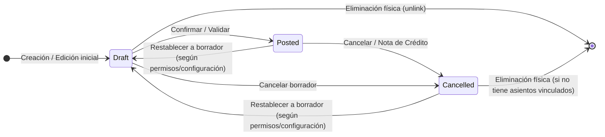
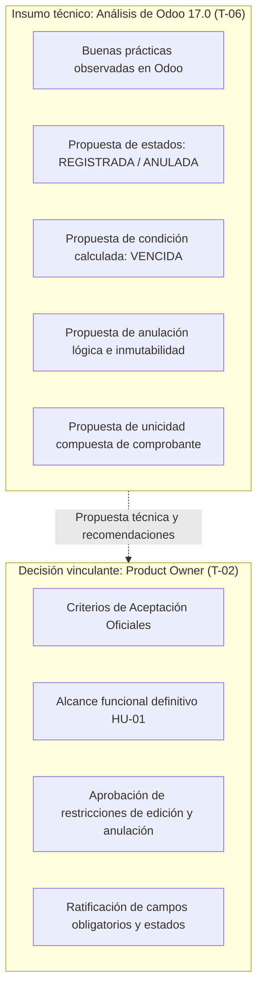

# Referencias de Odoo para el Primer CRUD de Cuentas por Pagar

**Proyecto:** ERP Financiero FSI — Tribu de Egresos  
**Módulo:** Cuentas por Pagar  
**Historia de usuario:** [HU-01 — Gestionar las obligaciones de Cuentas por Pagar](https://github.com/LeonHatches/fsi-erp-cuentas-por-pagar/issues/1)  
**Tarea:** [T-06 — Recopilar referencias de Odoo para el primer CRUD](https://github.com/LeonHatches/fsi-erp-cuentas-por-pagar/issues/7)  
**Responsable:** Romina Giuliana Camargo Hilachoque — Analista de Odoo, investigadora tecnológica y DevOps  
**Destinatarios clave:** José Manuel Morocco Saico (Frontend, [T-09](https://github.com/LeonHatches/fsi-erp-cuentas-por-pagar/issues/10) / [T-14](https://github.com/LeonHatches/fsi-erp-cuentas-por-pagar/issues/15)), Fernando Gerson Luque Guevara (Backend, [T-04](https://github.com/LeonHatches/fsi-erp-cuentas-por-pagar/issues/5) / [T-12](https://github.com/LeonHatches/fsi-erp-cuentas-por-pagar/issues/13)) y Fernando Rafael Solsol Choque (Product Owner, [T-02](https://github.com/LeonHatches/fsi-erp-cuentas-por-pagar/issues/3))  

---

## 1. Introducción y objetivo

El presente documento constituye el informe técnico de la tarea **T-06**, orientado a analizar cómo resuelve el ERP de referencia del mercado (**Odoo**, versión 17.0) la gestión de facturas de proveedores (*Vendor Bills*), a fin de extraer buenas prácticas funcionales, estructurales y de experiencia de usuario que orienten la construcción de nuestro **primer CRUD de obligaciones con proveedores**.

### 1.1 Contexto del proyecto
En el marco del curso Fundamentos de Sistemas de Información (Escuela Profesional de Ingeniería de Sistemas, Universidad Nacional de San Agustín de Arequipa), el módulo de **Cuentas por Pagar** administra las obligaciones y deudas que la empresa contrae con sus proveedores. Para su primer incremento funcional (**HU-01**), el alcance se encuentra rigurosamente acotado a cuatro operaciones esenciales:
1. **Registrar** obligaciones derivadas de comprobantes de compra.
2. **Consultar** el listado y el detalle de las obligaciones existentes.
3. **Modificar** los datos permitidos de una obligación no anulada.
4. **Anular** obligaciones con registro de motivo y preservación de auditoría.

### 1.2 Delimitación estricta del alcance
Para garantizar el cumplimiento de los acuerdos de equipo y los plazos de entrega:
- **No se implementa el registro ni la conciliación de pagos** (reservados para incrementos posteriores según el [plan del CRUD](../planificacion/primer-crud.md)).
- **No se desarrolla el módulo de Compras** ni el flujo de emparejamiento con órdenes de compra (*3-way matching* / PO). La propuesta de mantener este desacoplamiento para el primer CRUD se encuentra sujeta a la aprobación formal del Product Owner.
- **No se replica la contabilidad general de Odoo**, prescindiendo del motor multidimensional de asientos de diario, planes contables complejos o servicios de digitalización OCR por suscripción (IAP).

---

## 2. Análisis de las funcionalidades observadas en Odoo 17.0

En Odoo 17.0 (módulos *Invoicing* y *Accounting*), las obligaciones comerciales con proveedores se gestionan mediante el modelo `account.move` bajo el subtipo `in_invoice` (*Vendor Bill*). El análisis de su funcionamiento y documentación oficial revela los siguientes aspectos estructurales:

### 2.1 Ciclo de vida y estados del registro en Odoo 17.0

El flujo estándar de estados de una factura de proveedor en Odoo 17.0 se ilustra en el siguiente diagrama:



1. **Borrador (*Draft*):**
   - El documento se encuentra en fase de carga o preparación.
   - Todos los campos (proveedor, fechas, importes, líneas y cuentas) son completamente editables.
   - No genera impacto contable formal vinculante ni modifica los saldos exigibles en los libros oficiales.
   - En este estado, el registro puede eliminarse físicamente de la base de datos (*unlink*) si el usuario cuenta con los permisos correspondientes.
2. **Publicado / Confirmado (*Posted*):**
   - La obligación ha sido formalizada. Odoo le asigna una secuencia interna única (por ejemplo, `BILL/2026/11/0001`).
   - El documento pasa a formar parte de las cuentas por pagar exigibles e impacta en los informes de antigüedad de saldos (*Aged Payable*).
   - Los campos contables y financieros críticos quedan bloqueados para edición directa. No obstante, si la configuración de la compañía lo autoriza y no existen conciliaciones o bloqueos de período fiscal, Odoo permite la acción **Restablecer a borrador** (*Reset to Draft*) para realizar rectificaciones.
3. **Cancelado (*Cancelled*):**
   - Representa la cancelación o anulación del documento.
   - En Odoo, una factura cancelada no es estrictamente inmutable ni está exenta de eliminación bajo cualquier circunstancia:
     - Según las opciones de configuración contable y los privilegios de acceso, un documento cancelado puede ser restablecido a borrador (*Reset to Draft*) para su corrección o reutilización.
     - Asimismo, si no posee restricciones de asientos contables encadenados o si estos se desvinculan, Odoo admite la eliminación física del registro.
     - La práctica recomendada para operaciones formales es la emisión de una **Nota de Crédito de Proveedor (*Vendor Credit Note / Refund*)**, que genera un contra-asiento compensatorio sin destruir la trazabilidad histórica.

> [!IMPORTANT]
> **Diferenciación con la propuesta para el ERP FSI:**  
> A diferencia de Odoo 17.0, donde existen opciones de reactivación (*Reset to Draft*) y posible eliminación física en borrador o cancelación según configuración, en nuestro módulo proponemos una **anulación lógica estricta y permanente**:
> - En base de datos se proponen únicamente dos estados persistidos: **`REGISTRADA`** y **`ANULADA`**.
> - La anulación no elimina físicamente la fila en la tabla de base de datos (`DELETE`), sino que actualiza su estado a `ANULADA` exigiendo registrar el motivo de anulación.
> - Se propone que las obligaciones anuladas sean completamente inmutables y no admitan reactivación ni edición posterior.
> - Tanto los estados persistidos como las restricciones de anulación y no reactivación son **propuestas técnicas sujetas a la aprobación definitiva del Product Owner (Rafael Solsol, T-02)**.

### 2.2 Campos esenciales observados en Odoo 17.0

Al analizar la cabecera y el cuerpo del formulario de facturas de proveedor en Odoo 17.0, se identifican los siguientes campos fundamentales:

| Campo en Odoo 17.0 | Tipo de dato / Control | Comportamiento real en Odoo 17.0 | Propuesta técnica para nuestro CRUD (Sujeta a PO) |
|---|---|---|---|
| **Proveedor (*Vendor / `partner_id`*)** | Selector relacional / Búsqueda | Identifica la entidad comercial a la que se le adeuda. Obligatorio. | **Propuesta obligatoria**: Proveedor asociado a la obligación. |
| **Referencia de factura (*Bill Reference / `ref`*)** | Texto alfanumérico | Número o código del comprobante físico del emisor. **No es único en Odoo**: Odoo permite referencias repetidas (solo muestra una advertencia visual si coincide proveedor y fecha). | **Propuesta estructurada**: Campos separados de **Tipo de Comprobante**, **Serie** y **Número correlativo**, proponiendo una restricción de unicidad compuesta para registros no anulados. |
| **Fecha de factura (*Bill Date / `invoice_date`*)** | Selector de fecha | Fecha formal de emisión del comprobante. Obligatoria para confirmar. | **Propuesta obligatoria**: Fecha de emisión del comprobante. |
| **Fecha de vencimiento (*Due Date / `invoice_date_due`*)** | Selector de fecha | Fecha límite pactada para realizar el desembolso. | **Propuesta obligatoria**: Fecha de vencimiento para control de exigibilidad. |
| **Moneda (*Currency / `currency_id`*)** | Selector / Catálogo | Moneda en la que se pactó la obligación (PEN, USD, EUR). | **Propuesta obligatoria**: Selector de moneda (**Soles / Dólares**). |
| **Líneas de factura (*Invoice Lines*)** | Grilla editable multidistributiva | Desglose por producto, cuenta contable, cantidad, precio e impuestos. | **Propuesta simplificada**: Concepto general / glosa descriptiva e importe totalizado, sin desagregación contable analítica. |
| **Importe total (*Total Amount*)** | Numérico con decimales fijos | Monto total adeudado al proveedor. | **Propuesta obligatoria**: Importe numérico exacto no negativo (`NUMERIC(12, 2)`). |
| **Estado (*Status / `state`*)** | Barra de estado / Badge | Indica la etapa contable: `draft`, `posted`, `cancel`. | **Propuesta de estados persistidos**: Se propone almacenar en base de datos únicamente **`REGISTRADA`** y **`ANULADA`**. La condición **`VENCIDA`** se propone como un valor calculado dinámicamente en tiempo de ejecución. |

> [!NOTE]
> La definición final de qué campos son obligatorios u opcionales, así como las reglas de obligatoriedad en el registro, corresponden formalmente a los criterios de aceptación que determine el Product Owner en [T-02](https://github.com/LeonHatches/fsi-erp-cuentas-por-pagar/issues/3).

### 2.3 Procedimiento de modificación y restricciones en Odoo 17.0

En Odoo 17.0 existen directrices sobre la modificación de facturas de proveedor:
- Mientras la factura permanezca en **Borrador (*Draft*)**, cualquier usuario con permisos de facturación puede modificar libremente los datos del proveedor, fechas, cuentas, líneas e importes.
- Una vez **Confirmada (*Posted*)**, Odoo restringe la edición directa de campos con implicancia financiera directa (líneas de importe, diario, cuentas e impuestos) para salvaguardar la coherencia contable.
- No obstante, la edición no queda cerrada de manera irrevocable: si no existen pagos conciliados ni bloqueos fiscales de período, Odoo permite presionar **Restablecer a borrador (*Reset to Draft*)**, lo cual regresa el documento al estado editable.
- Alternativamente, si se requiere ajustar o anular una factura ya confirmada, el procedimiento contable estándar consiste en registrar una **Nota de Crédito (*Credit Note*)**.

**Contraste con la propuesta para el ERP FSI:**  
Para el primer CRUD de Cuentas por Pagar se propone un esquema más simple y directo:
1. Mientras la obligación esté en estado **`REGISTRADA`**, se propone permitir la modificación controlada de sus datos comerciales (fechas, concepto, moneda, importe).
2. Si la obligación pasa a estado **`ANULADA`**, se propone un **bloqueo estricto de edición**, impidiendo cualquier modificación posterior.
3. No se propone incorporar la opción de "Restablecer a borrador" ni reactivación de registros anulados.
*Toda restricción de edición y bloqueo de reactivación queda sujeta a la aprobación de Rafael Solsol (T-02).*

### 2.4 Procedimiento de anulación y reversión en Odoo 17.0

En Odoo 17.0 se distinguen diferentes vías de anulación:
- **En borrador:** El comprobante puede cancelarse (pasando a `cancel`) o bien eliminarse físicamente (`unlink`).
- **En publicado:** Se puede pulsar **Cancelar** (si la política contable del diario lo permite) o emitir una **Nota de Crédito de Proveedor (*Vendor Credit Note / Refund*)**, la cual revierte el saldo mediante un contra-asiento contable solicitando obligatoriamente un motivo de reversión (*Reason*).
- **Tratamiento posterior:** Como se indicó, Odoo no impone una inmutabilidad indestructible en todos los escenarios; facturas canceladas pueden restablecerse a borrador según permisos o eliminarse si se eliminan sus asientos vinculados.

**Diferenciación con la anulación lógica propuesta en el ERP FSI:**  
- En el ERP FSI no se crearán asientos de contrapartida ni notas de crédito complejas en este primer incremento.
- Se propone la **anulación lógica**: la obligación permanece en base de datos conservando su ID y datos originales, pero su estado persistido cambia a **`ANULADA`**, registrando de forma obligatoria el `motivo_anulacion` y la fecha de anulación.
- Se propone que esta anulación sea definitiva (sin reactivación). Esta regla técnica constituye una propuesta sujeta a la aprobación del Product Owner.

### 2.5 Validaciones y advertencias en Odoo 17.0

1. **Advertencia de comprobantes repetidos (no bloqueante en Odoo):**  
   Odoo 17.0 evalúa la combinación de Proveedor + Referencia de factura (*Bill Reference*). Si detecta otra factura con la misma referencia para ese proveedor, muestra un banner visual de advertencia informativa (*Duplicate bill reference detected*), pero **no impide guardar ni confirmar**, ya que a nivel de base de datos el campo `ref` no posee restricción única.  
   *Propuesta técnica para nuestro módulo:* A diferencia de Odoo, se propone implementar una restricción formal de base de datos (`UniqueConstraint`) sobre `(proveedor, tipo_comprobante, serie, numero)` para obligaciones registradas, sujeta a la decisión del Product Owner.
2. **Validación cronológica de fechas:**  
   Odoo valida que la fecha de vencimiento sea igual o posterior a la fecha del comprobante.
3. **Validación de importes:**  
   Odoo exige importes mayores a cero en facturas ordinarias. Los movimientos de disminución o abono se gestionan como notas de crédito.
4. **Diálogo de confirmación:**  
   Odoo solicita confirmación y captura de justificación cuando se ejecutan reversiones o cancelaciones.

---

## 3. Referencias de pantallas y fuentes oficiales de Odoo 17.0

La investigación técnica y funcional se basa en la documentación oficial de **Odoo 17.0**, versión estable seleccionada como estándar comparativo:

### 3.1 Documentación consultada (Odoo 17.0)

- **Gestión de facturas de proveedor (Vendor Bills):**  
  [Odoo 17.0 Documentation — Vendor Bills](https://www.odoo.com/documentation/17.0/applications/finance/accounting/vendor_bills.html)  
  *Describe la creación manual, campos de cabecera (Vendor, Bill Reference, Due Date) y tratamiento de líneas.*
- **Emisión de notas de crédito y reversiones (Credit Notes & Refunds):**  
  [Odoo 17.0 Documentation — Credit Notes](https://www.odoo.com/documentation/17.0/applications/finance/accounting/customer_invoices/credit_notes.html)  
  *Detalla el mecanismo de reversión contable mediante notas de crédito con especificación de motivo de anulación.*
- **Informes de antigüedad de cuentas por pagar (Aged Payable):**  
  [Odoo 17.0 Documentation — Reporting and Aged Payables](https://www.odoo.com/documentation/17.0/applications/finance/accounting/reporting.html)  
  *Muestra la consulta de obligaciones comerciales y control de vencimientos.*
- **Visión general de contabilidad y facturación:**  
  [Odoo 17.0 Documentation — Accounting Overview](https://www.odoo.com/documentation/17.0/applications/finance/accounting.html)  
  *Presenta la arquitectura modular del flujo de compras y cuentas por pagar.*

### 3.2 Análisis descriptivo de las vistas de Odoo 17.0

#### Vista 1: Listado de facturas de proveedor (*Tree View / List View*)
- **Estructura visual:** Tabla de registros con cabeceras ordenables y selección múltiple.
- **Columnas observables:** Secuencia interna (`BILL/202X/...`), Proveedor, Fecha de Factura, Fecha de Vencimiento, Referencia externa (`ref`), Importe Total y badges de estado contable (*Borrador*, *Publicado*, *Cancelado*) y de pago (*No pagado*, *Pagado*, *Parcial*).
- **Barra superior:** Botón principal "Nuevo", buscador dinámico, filtros (*No pagadas*, *Vencidas*) y opciones de agrupación por proveedor o fecha.

#### Vista 2: Formulario de factura de proveedor (*Form View*)
- **Barra de estado (*Statusbar*):** Muestra los botones de transición a la izquierda (`Confirmar`, `Cancelar`, `Restablecer a borrador`) y la barra secuencial de estados a la derecha (`Borrador` → `Publicado`).
- **Cabecera en dos columnas:**
  - Columna izquierda: Proveedor, Dirección/RUC y Referencia del comprobante (*Bill Reference*).
  - Columna derecha: Fecha de factura, Fecha contable, Fecha de vencimiento, Diario contable y Moneda.
- **Detalle inferior:** Grilla de conceptos y líneas contables, con resumen de subtotales, impuestos y total general.

#### Vista 3: Modal de cancelación y nota de crédito
- **Interrupción modal:** Cuadro emergente que se despliega al solicitar la reversión de una obligación confirmada.
- **Campos de captura:** Motivo de la reversión (*Reason* / texto obligatorio), Fecha del documento de reversión y Diario.
- **Acción:** Botón de confirmación visualmente destacado para prevenir ejecuciones accidentales.

---

### 3.3 Referencias visuales de Odoo 17.0

> [!WARNING]
> **Estado de las capturas: Pendientes de incorporación física**  
> Para asegurar la máxima integridad académica y cumplir las normas de revisión, **no se incorporan imágenes simuladas ni generadas por inteligencia artificial**. A continuación se delimitan los cuatro apartados específicos, sus rutas locales previstas en `docs/referencias/imagenes/`, sus descripciones funcionales y los enlaces oficiales de Odoo 17.0 para obtener las pantallas reales.  
> Las capturas visuales constituyen el **único entregable pendiente** de esta investigación, el cual será completado una vez que se extraigan las pantallas del entorno o documentación gráfica oficial de Odoo 17.0.

```
docs/referencias/
├── odoo-primer-crud.md
└── imagenes/
    ├── odoo17-listado-facturas.png       [CAPTURA PENDIENTE]
    ├── odoo17-formulario-factura.png     [CAPTURA PENDIENTE]
    ├── odoo17-detalle-estados-factura.png [CAPTURA PENDIENTE]
    └── odoo17-cancelacion-reversion.png  [CAPTURA PENDIENTE]
```

#### 1. Captura 1: Listado de facturas de proveedores

- **Estado:** `[CAPTURA PENDIENTE]`
- **Ruta prevista:** `imagenes/odoo17-listado-facturas.png`
- **Descripción requerida de la pantalla:** Debe mostrar la vista de lista (*List / Tree View*) del menú *Contabilidad / Facturación ‣ Proveedores ‣ Facturas* en Odoo 17.0. La captura debe evidenciar la disposición tabular de comprobantes, las columnas principales (Número interno, Proveedor, Fecha de Factura, Fecha de Vencimiento, Referencia externa, Total en moneda y Estado), así como los filtros de cabecera (*No pagadas*, *Vencidas*) y el botón de acción principal "Nuevo".
- **Enlace oficial de referencia:**  
  [Odoo 17.0 Documentation — Vendor Bills (List View)](https://www.odoo.com/documentation/17.0/applications/finance/accounting/vendor_bills.html)
- **Registro de fuente y fecha de consulta:**
  - *Fuente exacta de la captura:* `[Pendiente de registro tras captura]`
  - *Fecha de consulta / obtención:* `[Pendiente de registro]`

---

#### 2. Captura 2: Formulario de registro de una factura

- **Estado:** `[CAPTURA PENDIENTE]`
- **Ruta prevista:** `imagenes/odoo17-formulario-factura.png`
- **Descripción requerida de la pantalla:** Debe mostrar la vista de formulario (*Form View*) para la creación de una factura de proveedor en Odoo 17.0 en estado borrador (*Draft*). Debe observarse la barra superior de acciones, la organización en dos columnas de la cabecera (Proveedor, Referencia de factura, Fecha de emisión, Fecha de vencimiento y Moneda), y el área inferior donde se detallan las líneas del documento y los totales.
- **Enlace oficial de referencia:**  
  [Odoo 17.0 Documentation — Vendor Bills (Bill Creation)](https://www.odoo.com/documentation/17.0/applications/finance/accounting/vendor_bills.html)
- **Registro de fuente y fecha de consulta:**
  - *Fuente exacta de la captura:* `[Pendiente de registro tras captura]`
  - *Fecha de consulta / obtención:* `[Pendiente de registro]`

---

#### 3. Captura 3: Vista de detalle y estados de una factura

- **Estado:** `[CAPTURA PENDIENTE]`
- **Ruta prevista:** `imagenes/odoo17-detalle-estados-factura.png`
- **Descripción requerida de la pantalla:** Debe mostrar la vista de consulta o detalle de una factura de proveedor en estado publicado / confirmado (*Posted*) en Odoo 17.0. Se debe apreciar la barra de estado (*Statusbar*) que indica el progreso visual del documento (`Borrador` → `Publicado`), la secuencia interna asignada (`BILL/...`), los botones de acción contextuales (`Restablecer a borrador` / `Nota de crédito`) y el bloqueo de edición directa de los campos contables.
- **Enlace oficial de referencia:**  
  [Odoo 17.0 Documentation — Vendor Bills (Validation & Status)](https://www.odoo.com/documentation/17.0/applications/finance/accounting/vendor_bills.html)
- **Registro de fuente y fecha de consulta:**
  - *Fuente exacta de la captura:* `[Pendiente de registro tras captura]`
  - *Fecha de consulta / obtención:* `[Pendiente de registro]`

---

#### 4. Captura 4: Proceso de cancelación o reversión

- **Estado:** `[CAPTURA PENDIENTE]`
- **Ruta prevista:** `imagenes/odoo17-cancelacion-reversion.png`
- **Descripción requerida de la pantalla:** Debe mostrar el cuadro de diálogo modal o asistente de cancelación / reversión en Odoo 17.0 (mediante emisión de Nota de Crédito / *Credit Note* o acción de cancelar). Debe observarse la solicitud obligatoria del motivo de anulación (*Reason*), la fecha de la reversión contable y el botón primario de confirmación que asegura la trazabilidad de la operación.
- **Enlace oficial de referencia:**  
  [Odoo 17.0 Documentation — Credit Notes and Reversals](https://www.odoo.com/documentation/17.0/applications/finance/accounting/customer_invoices/credit_notes.html)
- **Registro de fuente y fecha de consulta:**
  - *Fuente exacta de la captura:* `[Pendiente de registro tras captura]`
  - *Fecha de consulta / obtención:* `[Pendiente de registro]`

---

## 4. Tabla comparativa entre Odoo 17.0 y nuestro primer CRUD

Para asegurar que el equipo delimite con precisión el desarrollo sin asumir complejidades innecesarias, se presenta la contrastación formal entre el alcance de Odoo 17.0 y las propuestas técnicas para nuestro proyecto:

| Dimensión | Odoo 17.0 (Módulo Contabilidad/Compras) | Propuesta para el Primer CRUD (ERP FSI — Egresos) | Justificación técnica y validación |
|---|---|---|---|
| **Alcance general** | ERP integral con contabilidad general, inventarios, compras y facturación electrónica. | **Primer incremento (HU-01)**: Gestión básica de deudas con proveedores (Registrar, Consultar, Modificar, Anular). | Alcance acotado incremental; prioriza la consistencia operativa del CRUD. |
| **Identificación del comprobante** | Campo alfanumérico `ref` (*Bill Reference*). **No es único** en BD; Odoo solo advierte duplicidad visualmente. | **Propuesta estructurada**: Campos separados de **Tipo de Comprobante**, **Serie** y **Número correlativo** con propuesta de unicidad compuesta. | *Propuesta técnica sujeta a aprobación del Product Owner en T-02.* |
| **Estructura del detalle** | Desglose analítico en múltiples líneas con cuentas contables, impuestos y centros de costo. | **Registro simplificado a nivel de cabecera**: Concepto general descriptivo e Importe total. | Evita complejidad contable innecesaria para el primer CRUD. |
| **Gestión de monedas** | Motor multidivisa con actualización diaria de tasas de cambio y cálculo de diferencial cambiario. | **Selector de moneda**: Soles (`PEN`) o Dólares (`USD`), registrando el importe en moneda pactada. | *Propuesta técnica sujeta a validación del Product Owner en T-02.* |
| **Estados del registro en base de datos** | Estados contables en Odoo: `draft` (Borrador), `posted` (Publicado) y `cancel` (Cancelado). | **Propuesta de estados persistidos**: Se propone almacenar en BD únicamente **`REGISTRADA`** y **`ANULADA`**. La condición **`VENCIDA`** se propone como cálculo dinámico. | Se elimina la ambigüedad con `ACTIVA`. Permite una persistencia limpia en BD (`REGISTRADA` / `ANULADA`), mientras que el vencimiento se evalúa dinámicamente. *Propuesta sujeta a aprobación del Product Owner en T-02.* |
| **Modificación de datos** | Campos contables bloqueados en publicado; permite volver a borrador (*Reset to Draft*) según configuración contable. | **Modificación directa controlada** mientras esté en estado `REGISTRADA`. Inmutabilidad total en estado `ANULADA`. | Brinda flexibilidad operativa controlada. *Propuesta técnica sujeta a aprobación del Product Owner en T-02.* |
| **Anulación y reactivación** | Permite cancelar, emitir notas de crédito con contra-asientos, o restablecer a borrador según permisos. | **Anulación lógica**: Cambio de estado persistido a `ANULADA` con registro obligatorio de `motivo_anulacion`. No se admite reactivación ni eliminación física. | Preserva auditoría sin requerir notas de crédito complejas. *Propuesta de no reactivación sujeta a aprobación del Product Owner en T-02.* |
| **Gestión de pagos** | Asistente de pagos, conciliación bancaria y lotes de pago. | **Fuera de alcance en HU-01**. El registro de pagos se desarrollará en un incremento posterior. | Delimitación estipulada en la [planificación del CRUD](../planificacion/primer-crud.md). |
| **Integración con compras** | Integración nativa con recepciones de almacén y órdenes de compra (*3-way matching*). | **Propuesta de desacoplamiento**: No se vincula al módulo de Compras en HU-01; se contempla únicamente un campo opcional de referencia externa de compra. | *Propuesta de desacoplamiento sujeta a aprobación formal del Product Owner en T-02.* |

---

## 5. Recomendaciones para el diseño de Wireframes (Frontend)

Para apoyar a nuestro compañero **José Manuel Morocco Saico** ([T-09](https://github.com/LeonHatches/fsi-erp-cuentas-por-pagar/issues/10) y [T-14](https://github.com/LeonHatches/fsi-erp-cuentas-por-pagar/issues/15)), se formulan recomendaciones de diseño basadas en los patrones de Odoo 17.0, alineadas y armonizadas con los bocetos preliminares de interfaz:

### 5.1 Pantalla 1: Listado de obligaciones (*List View*)
1. **Disposición tabular clara:**
   - Columnas primarias: *Proveedor*, *Comprobante (Tipo + Serie-Número)*, *Fecha de Emisión*, *Fecha de Vencimiento*, *Moneda*, *Importe* y *Estado*.
   - Los importes deben estar formateados a dos decimales y alineados a la derecha.
2. **Badges de estado y condición de vencimiento:**
   - En concordancia con los bocetos de José Manuel (T-09) y la definición de backend de Fernando Gerson (T-04), se recomienda presentar tres etiquetas visuales bien diferenciadas:
     - **`REGISTRADA`**: Badge verde suave o azul suave (`bg-emerald-100 text-emerald-800` o `bg-blue-100 text-blue-800`), indicando que la obligación está vigente y no vencida.
     - **`VENCIDA`**: Badge ámbar o naranja (`bg-amber-100 text-amber-800`), aplicado cuando la condición calculada detecta que `fecha_vencimiento < fecha_actual` y la obligación sigue en estado registrado.
     - **`ANULADA`**: Badge rojo o gris (`bg-red-100 text-red-800` o `bg-slate-100 text-slate-700`), indicando que la obligación fue dada de baja de manera lógica.
3. **Filtros rápidos y búsqueda:**
   - Buscador en tiempo real por proveedor o serie/número de comprobante.
   - Pestañas o botones de filtro rápido: *Todas*, *Registradas*, *Vencidas* (filtro por condición calculada), *Anuladas*.
4. **Acciones contextuales por fila:**
   - Botón **Ver Detalle**: siempre visible y habilitado.
   - Botón **Editar**: habilitado si la obligación está en estado `REGISTRADA` (incluso si está visualmente vencida); inhabilitado u oculto si está `ANULADA`.
   - Botón **Anular**: habilitado únicamente si está en estado `REGISTRADA`.
   - *Nota:* Las restricciones de edición y anulación quedan sujetas a la aprobación definitiva del Product Owner (Rafael Solsol).
5. **Manejo de estados visuales especiales:**
   - *Estado vacío (*Empty State*)*: Mensaje amigable con ilustración cuando no haya registros coincidentes.
   - *Estado de carga (*Skeleton / Spinner*)*: Indicador visual mientras responde la API.
   - *Estado de error*: Mensaje claro con opción de reintentar la solicitud.

### 5.2 Pantalla 2: Formulario de registro y edición (*Form View*)
1. **Organización en dos paneles visuales:**
   - **Panel A — Identificación del Comprobante:** Selector de Proveedor (con autocompletado), Tipo de Comprobante (Factura, Boleta, Recibo por Honorarios), Serie (ej. `F001`), Número correlativo (ej. `00012450`) y Referencia de compra (opcional).
   - **Panel B — Condiciones Comerciales:** Fecha de Emisión, Fecha de Vencimiento, Moneda (PEN / USD), Importe Total y Concepto / Glosa general.
2. **Claridad en modo edición:**
   - Mostrar de forma destacada el comprobante que se encuentra en edición.
   - Inhabilitar campos estructurales que no deben alterarse una vez creados si la regla de negocio lo ratifica (por ejemplo, el ID del registro o el estado).
3. **Validación visual inmediata (*Inline Feedback*):**
   - Marcar con borde rojo suave (`border-red-500`) y mensaje explicativo cualquier campo con valor requerido ausente o formato inválido.
   - Deshabilitar el botón de envío mientras existan inconsistencias evidentes en cliente.

### 5.3 Pantalla 3: Detalle de la obligación (*Detail View*)
1. **Ficha de Obligación:**
   - Estructura de solo lectura ordenada con datos comerciales y datos de trazabilidad (fecha y hora de registro, fecha y hora de anulación, motivo de anulación si aplica).
2. **Navegación y acciones:**
   - Botón superior para retornar al listado (`← Volver al listado`).
   - Acciones de `Editar` o `Anular` disponibles directamente en la cabecera si la obligación permanece en estado `REGISTRADA`.

### 5.4 Pantalla 4: Cuadro modal de anulación (*Cancel Confirmation Modal*)
1. **Prevención de errores operativos:**
   - Diálogo modal con fondo bloqueante semitransparente oscuro y encabezado de advertencia.
2. **Captura obligatoria de justificación:**
   - Campo de texto multilínea (*Textarea*) para ingresar el **Motivo de Anulación** (mínimo de 10 a 15 caracteres para evitar entradas vacías o triviales).
3. **Advertencia de no reactivación:**
   - Mensaje explícito: *"Esta acción anulará la obligación de forma lógica. El registro permanecerá en el sistema para fines de auditoría pero no podrá ser editado ni reactivado."*
   - *Propuesta sujeta a validación y aprobación del Product Owner.*

---

## 6. Reglas de validación sugeridas vs. Criterios del Product Owner

Es indispensable distinguir las sugerencias técnicas derivadas del análisis de Odoo 17.0 respecto a las decisiones de negocio que corresponden exclusivamente al **Product Owner (Fernando Rafael Solsol Choque, [T-02](https://github.com/LeonHatches/fsi-erp-cuentas-por-pagar/issues/3))**:



### 6.1 Matriz de diferenciación de reglas y validaciones

| Aspecto | Comportamiento real en Odoo 17.0 | Regla técnica propuesta desde T-06 | Criterio oficial del Product Owner (T-02) |
|---|---|---|---|
| **Comprobantes repetidos** | Odoo no bloquea a nivel de BD; el campo `ref` permite duplicados. Solo muestra un banner informativo si coincide proveedor y fecha. | **Propuesta de restricción única (`UniqueConstraint`)**: La tupla `(proveedor, tipo_comprobante, serie, numero)` debe ser única para obligaciones en estado `REGISTRADA`. | *Propuesta técnica sujeta a ratificación formal del Product Owner en T-02.* |
| **Validación de fechas** | Alerta si la fecha de vencimiento es previa a la fecha de emisión. | **Regla de integridad cronológica**: `fecha_vencimiento >= fecha_emision` y `fecha_emision <= fecha_actual` (evitar fechas futuras no razonables). | *Propuesta técnica sujeta a los criterios de aceptación de T-02.* |
| **Importe del comprobante** | No admite importes negativos en facturas regulares. | **Restricción de monto positivo (`CheckConstraint`)**: El importe debe ser estrictamente mayor que cero (`importe > 0.00`), con tipo `NUMERIC(12, 2)`. | *Propuesta técnica contemplada en la arquitectura técnica, sujeta a ratificación en T-02.* |
| **Campos obligatorios** | Proveedor, fecha de factura y al menos una línea contable. | **Propuesta de campos requeridos**: Proveedor, Tipo de Comprobante, Serie, Número, Fecha Emisión, Fecha Vencimiento, Moneda e Importe. Concepto y Referencia de compra como opcionales. | *Definición de obligatoriedad sujeta a la aprobación formal del Product Owner en T-02.* |
| **Estados en base de datos** | Persiste `draft`, `posted` y `cancel`. | **Propuesta de persistencia limpia**: Almacenar en base de datos únicamente `REGISTRADA` y `ANULADA`. La condición `VENCIDA` se propone como cálculo dinámico (`fecha_vencimiento < fecha_actual`). | *Propuesta técnica consensuada con Backend y Frontend, sujeta a validación final de Rafael en T-02.* |
| **Restricciones de edición** | Campos contables bloqueados en publicado, pero permite "Restablecer a borrador" según configuración. | **Propuesta de edición permitida solo en `REGISTRADA`**: Si `estado == 'ANULADA'`, los endpoints deben retornar error HTTP `400 Bad Request` o `409 Conflict`. | *Propuesta técnica sujeta a la aprobación formal del Product Owner en T-02.* |
| **Restricciones de anulación y reactivación** | Odoo permite cancelar, emitir nota de crédito o restablecer a borrador facturas canceladas según permisos. | **Propuesta de anulación lógica irrevocable**: `motivo_anulacion` obligatorio; no se permite reapertura, reactivación ni eliminación física. | *Propuesta técnica sujeta a la aprobación formal del Product Owner en T-02.* |
| **Integración con Compras** | Acoplamiento nativo con órdenes de compra y recepciones (*3-way matching*). | **Propuesta de desacoplamiento para HU-01**: Cuentas por Pagar opera de forma autónoma con un campo opcional de referencia externa de compra. | *Propuesta de desacoplamiento sujeta a aprobación formal del Product Owner en T-02.* |

> [!IMPORTANT]
> Las reglas y restricciones técnicas recomendadas en este informe constituyen insumos de diseño para facilitar el trabajo de Backend ([T-12](https://github.com/LeonHatches/fsi-erp-cuentas-por-pagar/issues/13)), Frontend ([T-09](https://github.com/LeonHatches/fsi-erp-cuentas-por-pagar/issues/10)) y QA ([T-08](https://github.com/LeonHatches/fsi-erp-cuentas-por-pagar/issues/9)). **No reemplazan los criterios de aceptación vinculantes que apruebe el Product Owner Rafael Solsol para la historia de usuario HU-01.**

---

## 7. Conclusiones y bibliografía

### 7.1 Conclusiones principales

1. **La anulación lógica propuesta responde a las necesidades del ERP FSI:** A diferencia de Odoo 17.0, donde la inmutabilidad y la eliminación física dependen de configuraciones contables y estados reversibles (*Reset to Draft*), la propuesta de anulación lógica permanente (`ANULADA` con motivo obligatorio) garantiza la trazabilidad exigida por la auditoría académica y sienta una base firme para el futuro registro de pagos.
2. **Definición limpia de estados:** Proponer para la base de datos únicamente los estados persistidos **`REGISTRADA`** y **`ANULADA`**, tratando **`VENCIDA`** como una condición calculada en tiempo de ejecución, elimina la ambigüedad conceptual previa (`ACTIVA` vs `REGISTRADA`), aligera el modelo relacional y armoniza con los bocetos de Frontend y los modelos de Backend.
3. **Simplicidad orientada a HU-01:** La delimitación estricta de campos y el desacoplamiento respecto al módulo de Compras previenen la sobreingeniería, permitiendo al equipo concentrarse en la robustez y calidad del primer incremento funcional.
4. **Respeto a las atribuciones del Product Owner:** Todas las recomendaciones sobre obligatoriedad de campos, restricciones de edición, reglas de anulación, no reactivación y desacoplamiento con Compras quedan explícitamente establecidas como propuestas técnicas sujetas a la aprobación vinculante de Rafael Solsol ([T-02](https://github.com/LeonHatches/fsi-erp-cuentas-por-pagar/issues/3)).
5. **Entregables visuales pendientes:** Se han estructurado rigurosamente los espacios, rutas locales en `docs/referencias/imagenes/` y especificaciones de las cuatro capturas requeridas de Odoo 17.0, dejando claramente señalado que su incorporación física es el único pendiente de esta tarea una vez atendidas las observaciones conceptuales.

---

### 7.2 Bibliografía y fuentes oficiales (Odoo 17.0)

1. **Odoo S.A.** (2024). *Vendor Bills and Receipts — Accounting Documentation (v17.0)*. Recuperado de:  
   https://www.odoo.com/documentation/17.0/applications/finance/accounting/vendor_bills.html
2. **Odoo S.A.** (2024). *Customer Invoices and Credit Notes — Accounting Documentation (v17.0)*. Recuperado de:  
   https://www.odoo.com/documentation/17.0/applications/finance/accounting/customer_invoices/credit_notes.html
3. **Odoo S.A.** (2024). *Reporting and Aged Payable Balance — Accounting Documentation (v17.0)*. Recuperado de:  
   https://www.odoo.com/documentation/17.0/applications/finance/accounting/reporting.html
4. **Odoo S.A.** (2024). *Odoo Accounting User Documentation (v17.0)*. Recuperado de:  
   https://www.odoo.com/documentation/17.0/applications/finance/accounting.html
5. **Guillen, D., & Mengoa, B.** (2026). *Documento de Arquitectura de Software: Módulo Cuentas por Pagar — ERP Financiero FSI*. Universidad Nacional de San Agustín de Arequipa. [docs/arquitectura/ARQUITECTURA.md](../arquitectura/ARQUITECTURA.md).
6. **Hatches, J. L. E.** (2026). *Planificación del Primer CRUD: Cuentas por Pagar*. Universidad Nacional de San Agustín de Arequipa. [docs/planificacion/primer-crud.md](../planificacion/primer-crud.md).
